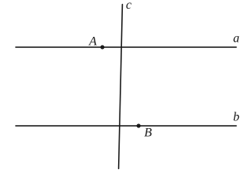
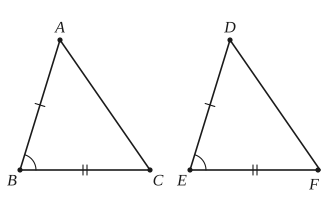
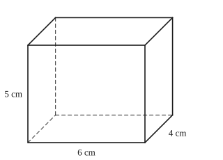

# Đề kiểm tra số 1

**Thời gian làm bài:** 90 phút. **Thang điểm:** mỗi câu 1 điểm, tổng 10 điểm.

## Đề bài

**Câu 1 (Số hữu tỉ).** Tính: a) $\left(-\dfrac{2}{3} + \dfrac{3}{4}\right) : \dfrac{5}{12}$; b) $\left(-\dfrac{1}{2}\right)^3$.

**Câu 2 (Số thực).** a) Tính $\sqrt{49} + \sqrt{0{,}25}$. b) Làm tròn $\sqrt{2} \approx 1{,}41421\dots$ đến hàng phần trăm. c) So sánh $\sqrt{17}$ và 4.

**Câu 3 (Song song).** Cho hai đường thẳng song song $a$, $b$ bị cắt bởi đường thẳng $c$ tại $A$ và $B$. Biết góc tạo bởi tia $Ac$ (phía trên) và tia của $a$ bên phải $A$ bằng $65^\circ$. Tính số đo các góc tạo bởi $c$ và $b$ tại $B$.

**Câu 4 (Tam giác bằng nhau).** Cho hai tam giác $ABC$ và $DEF$ có $AB = DE$, $\widehat{B} = \widehat{E}$, $BC = EF$. Hai tam giác có bằng nhau không? Nếu $AC = 7$ cm thì $DF$ bằng bao nhiêu?

**Câu 5 (Xác suất).** Gieo một con xúc xắc cân đối. Tính xác suất của biến cố “số chấm xuất hiện chia hết cho 3”.

**Câu 6 (Dãy tỉ số).** Tìm $x, y$ biết $\dfrac{x}{5} = \dfrac{y}{3}$ và $x - y = 8$.

**Câu 7 (Tỉ lệ nghịch).** 8 công nhân làm xong một công việc trong 15 ngày. Hỏi 12 công nhân (năng suất như nhau) làm xong công việc đó trong bao nhiêu ngày?

**Câu 8 (Đa thức).** Cho $P(x) = 3x^2 - 2x + 5 - x^2 + 4x$. Thu gọn $P(x)$ và tính $P(-1)$.

**Câu 9 (Bất đẳng thức tam giác).** Một tam giác có hai cạnh dài 3 cm và 8 cm. Cạnh thứ ba là số nguyên (cm) lớn nhất có thể. Tính cạnh thứ ba.

**Câu 10 (Hình hộp chữ nhật).** Tính thể tích và diện tích xung quanh của hình hộp chữ nhật có đáy 6 cm × 4 cm, chiều cao 5 cm.

---

## Lời giải chi tiết

### Câu 1
a) $\dfrac{1}{12} \cdot \dfrac{12}{5} = \dfrac{1}{5}$. b) $-\dfrac{1}{8}$.

### Câu 2
a) $7 + 0{,}5 = 7{,}5$. b) $1{,}41$. c) $\sqrt{17} > \sqrt{16} = 4$.

### Câu 3

*Hình: Hai đường thẳng song song a, b bị cắt bởi đường thẳng c.*

Tại $B$: góc đồng vị với góc $65^\circ$ bằng $65^\circ$; góc đối đỉnh với nó bằng $65^\circ$; hai góc còn lại (kề bù) bằng $180^\circ - 65^\circ = 115^\circ$.

### Câu 4

*Hình: Hai tam giác ABC và DEF có AB = DE, góc B bằng góc E, BC = EF.*

$\triangle ABC = \triangle DEF$ (c.g.c), nên $DF = AC = 7$ cm.

### Câu 5
Có 6 kết quả đồng khả năng; mặt 3 và 6 thuận lợi. $P = \dfrac{2}{6} = \dfrac{1}{3}$.

### Câu 6
$\dfrac{x}{5} = \dfrac{y}{3} = \dfrac{x - y}{2} = 4$. Vậy $x = 20$, $y = 12$.

### Câu 7
$8 \cdot 15 = 12 \cdot t$, $t = 10$ (ngày).

### Câu 8
$P(x) = 2x^2 + 2x + 5$. $P(-1) = 2 - 2 + 5 = 5$.

### Câu 9
$8 - 3 < c < 8 + 3$, tức $5 < c < 11$. Số nguyên lớn nhất: $c = 10$ cm.

### Câu 10

*Hình: Hình hộp chữ nhật 6 cm × 4 cm × 5 cm.*

$V = 6 \cdot 4 \cdot 5 = 120 \text{ (cm}^3)$. $S_{xq} = 2(6 + 4) \cdot 5 = 100 \text{ (cm}^2)$.
