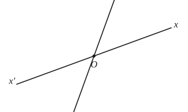
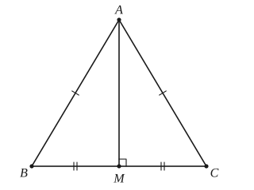
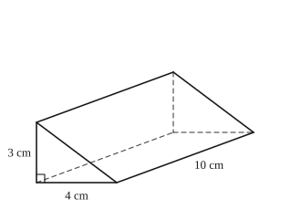

# Đề kiểm tra số 2

**Thời gian làm bài:** 90 phút. **Thang điểm:** mỗi câu 1 điểm, tổng 10 điểm.

## Đề bài

**Câu 1 (Tìm x).** Tìm $x$: a) $x + \dfrac{2}{3} = -\dfrac{1}{4}$; b) $\dfrac{2}{5}x - 1 = \dfrac{3}{5}$.

**Câu 2 (Số thực).** a) Tìm $x$ biết $\lvert x\rvert = 2{,}5$. b) Trong các số $\sqrt{9}$; $\sqrt{5}$; $0{,}(3)$; $\pi$, số nào là số vô tỉ?

**Câu 3 (Góc).** Hai đường thẳng $xx'$ và $yy'$ cắt nhau tại $O$, $\widehat{xOy} = 50^\circ$. Tính $\widehat{x'Oy'}$ và $\widehat{x'Oy}$.

**Câu 4 (Tam giác cân).** Cho tam giác $ABC$ cân tại $A$ có $\widehat{A} = 50^\circ$, $M$ là trung điểm $BC$. a) Tính $\widehat{B}$, $\widehat{C}$. b) Chứng minh $AM \perp BC$.

**Câu 5 (Biểu đồ).** Lớp 7A có 40 học sinh. Trên biểu đồ hình quạt về môn thể thao yêu thích, phần bóng đá chiếm 35%. Có bao nhiêu học sinh thích bóng đá?

**Câu 6 (Chia tỉ lệ).** Ba lớp trồng được 120 cây, số cây tỉ lệ với 3, 4, 5. Tính số cây mỗi lớp.

**Câu 7 (Tỉ lệ nghịch).** Cho $y$ tỉ lệ nghịch với $x$; khi $x = 4$ thì $y = 6$. Tìm hệ số tỉ lệ và tính $y$ khi $x = 8$.

**Câu 8 (Đa thức).** a) Thực hiện phép nhân $(2x - 1)(x + 3)$. b) Tìm nghiệm của đa thức $2x - 6$.

**Câu 9 (Trọng tâm).** Cho tam giác $ABC$ có trung tuyến $AM = 12$ cm, $G$ là trọng tâm. Tính $AG$ và $GM$.

**Câu 10 (Lăng trụ đứng).** Một lăng trụ đứng tam giác có đáy là tam giác vuông với các cạnh 3 cm, 4 cm, 5 cm, chiều cao lăng trụ 10 cm. Tính diện tích xung quanh và thể tích.

---

## Lời giải chi tiết

### Câu 1
a) $x = -\dfrac{1}{4} - \dfrac{2}{3} = -\dfrac{11}{12}$. b) $\dfrac{2}{5}x = \dfrac{8}{5}$, $x = 4$.

### Câu 2
a) $x = 2{,}5$ hoặc $x = -2{,}5$. b) $\sqrt{9} = 3$ và $0{,}(3) = \dfrac{1}{3}$ là số hữu tỉ; $\sqrt{5}$ và $\pi$ là số vô tỉ.

### Câu 3

*Hình: Góc xOy và góc đối đỉnh x'Oy'.*

$\widehat{x'Oy'} = \widehat{xOy} = 50^\circ$ (đối đỉnh). $\widehat{x'Oy} = 180^\circ - 50^\circ = 130^\circ$ (kề bù).

### Câu 4

*Hình: Tam giác ABC cân tại A với trung tuyến AM.*

a) $\widehat{B} = \widehat{C} = \dfrac{180^\circ - 50^\circ}{2} = 65^\circ$.
b) $\triangle ABM = \triangle ACM$ (c.c.c) nên $\widehat{AMB} = \widehat{AMC}$; hai góc kề bù nên mỗi góc $90^\circ$.

### Câu 5
$40 \cdot 35\% = 14$ (học sinh).

### Câu 6
$\dfrac{x}{3} = \dfrac{y}{4} = \dfrac{z}{5} = \dfrac{120}{12} = 10$: 30, 40, 50 cây.

### Câu 7
$a = 4 \cdot 6 = 24$; $y = \dfrac{24}{8} = 3$.

### Câu 8
a) $2x^2 + 6x - x - 3 = 2x^2 + 5x - 3$. b) $2x - 6 = 0 \Leftrightarrow x = 3$.

### Câu 9
$AG = \dfrac{2}{3} \cdot 12 = 8$ (cm); $GM = 4$ cm.

### Câu 10

*Hình: Lăng trụ đứng tam giác có đáy là tam giác vuông cạnh 3 cm, 4 cm, 5 cm, chiều cao 10 cm.*

$S_{xq} = (3 + 4 + 5) \cdot 10 = 120 \text{ (cm}^2)$. $V = \dfrac{3 \cdot 4}{2} \cdot 10 = 60 \text{ (cm}^3)$.
