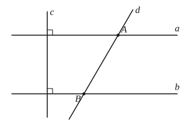
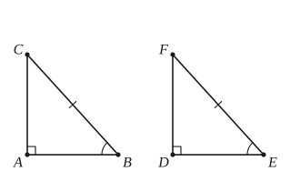
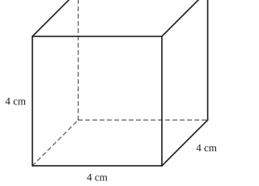

# Đề kiểm tra số 3

**Thời gian làm bài:** 90 phút. **Thang điểm:** mỗi câu 1 điểm, tổng 10 điểm.

## Đề bài

**Câu 1 (Lũy thừa).** Tính: a) $2^5 \cdot 2^3 : 2^6$; b) $(0{,}25)^3 \cdot 64$.

**Câu 2 (Số thực).** Sắp xếp theo thứ tự tăng dần: $-1{,}5$; $\sqrt{2}$; $-\sqrt{3}$; $1{,}4$.

**Câu 3 (Song song).** Hai đường thẳng $a$, $b$ cùng vuông góc với đường thẳng $c$. Đường thẳng $d$ cắt $a$ tại $A$, cắt $b$ tại $B$; góc tạo bởi $d$ và $a$ tại $A$ (góc nằm phía dưới $a$, bên trái $d$) bằng $120^\circ$. Vì sao $a \parallel b$? Tính góc tạo bởi $d$ và $b$ tại $B$ ở vị trí so le trong với góc đó.

**Câu 4 (Tam giác vuông).** Cho tam giác $ABC$ vuông tại $A$ và tam giác $DEF$ vuông tại $D$ có $BC = EF$, $\widehat{B} = \widehat{E}$. Chứng minh $\triangle ABC = \triangle DEF$.

**Câu 5 (Xác suất).** Rút ngẫu nhiên một thẻ trong 20 thẻ đánh số từ 1 đến 20. Tính xác suất để số trên thẻ là số nguyên tố.

**Câu 6 (Dãy tỉ số).** Tìm $x, y, z$ biết $\dfrac{x}{2} = \dfrac{y}{3} = \dfrac{z}{4}$ và $x + 2y - z = 12$.

**Câu 7 (Tỉ lệ thuận).** Mua 15 m vải hết 1 350 000 đồng. Hỏi mua 20 m vải cùng loại hết bao nhiêu tiền?

**Câu 8 (Cộng đa thức).** Cho $P(x) = x^3 - 2x^2 + x - 3$ và $Q(x) = -x^3 + 3x^2 - 2$. Tính $P(x) + Q(x)$.

**Câu 9 (Góc và cạnh).** Tam giác $ABC$ có $\widehat{A} = 100^\circ$, $\widehat{B} = 30^\circ$. Sắp xếp ba cạnh theo thứ tự từ lớn đến bé.

**Câu 10 (Hình lập phương).** Tính diện tích toàn phần và thể tích hình lập phương cạnh 4 cm.

---

## Lời giải chi tiết

### Câu 1
a) $2^8 : 2^6 = 4$. b) $\left(\dfrac{1}{4}\right)^3 \cdot 4^3 = 1$.

### Câu 2
$\sqrt{3} \approx 1{,}73$ nên $-\sqrt{3} < -1{,}5$; $\sqrt{2} \approx 1{,}414 > 1{,}4$. Thứ tự: $-\sqrt{3} < -1{,}5 < 1{,}4 < \sqrt{2}$.

### Câu 3

*Hình: Hai đường thẳng a, b cùng vuông góc với c và đường thẳng d cắt chúng.*

Hai đường thẳng cùng vuông góc với một đường thẳng thì song song: $a \parallel b$. Góc so le trong với góc $120^\circ$ bằng $120^\circ$.

### Câu 4

*Hình: Hai tam giác vuông ABC (vuông tại A) và DEF (vuông tại D) có BC = EF, góc B bằng góc E.*

Hai tam giác vuông có cạnh huyền $BC = EF$ và góc nhọn $\widehat{B} = \widehat{E}$, nên bằng nhau (cạnh huyền – góc nhọn).

### Câu 5
Các số nguyên tố: 2, 3, 5, 7, 11, 13, 17, 19 (8 số). $P = \dfrac{8}{20} = \dfrac{2}{5}$.

### Câu 6
Đặt $x = 2k$, $y = 3k$, $z = 4k$: $2k + 6k - 4k = 4k = 12$, $k = 3$. Vậy $x = 6$, $y = 9$, $z = 12$.

### Câu 7
1 m giá $1\,350\,000 : 15 = 90\,000$ (đồng); 20 m giá $1\,800\,000$ đồng.

### Câu 8
$P + Q = x^2 + x - 5$.

### Câu 9
$\widehat{C} = 50^\circ$. $\widehat{A} > \widehat{C} > \widehat{B}$ nên $BC > AB > AC$.

### Câu 10

*Hình: Hình lập phương cạnh 4 cm.*

$S_{tp} = 6 \cdot 16 = 96 \text{ (cm}^2)$; $V = 64 \text{ cm}^3$.
