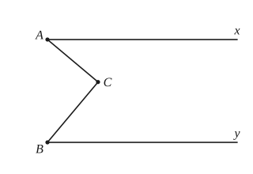
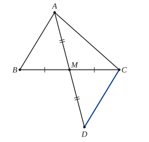

# Đề kiểm tra số 4

**Thời gian làm bài:** 90 phút. **Thang điểm:** mỗi câu 1 điểm, tổng 10 điểm.

## Đề bài

**Câu 1 (Tính hợp lý).** Tính bằng cách hợp lý: $-\dfrac{3}{7} \cdot \dfrac{2}{5} + \left(-\dfrac{3}{7}\right) \cdot \dfrac{3}{5}$.

**Câu 2 (Số thập phân tuần hoàn).** Viết các số $0{,}(6)$ và $1{,}(3)$ dưới dạng phân số tối giản.

**Câu 3 (Góc và song song).** Cho hai tia $Ax$ và $By$ song song, cùng chiều. Điểm $C$ nằm giữa hai đường thẳng chứa hai tia sao cho $\widehat{xAC} = 40^\circ$, $\widehat{yBC} = 50^\circ$. Tính $\widehat{ACB}$.

**Câu 4 (Tam giác bằng nhau).** Cho tam giác $ABC$, $M$ là trung điểm của $BC$. Trên tia đối của tia $MA$ lấy $D$ sao cho $MD = MA$. Chứng minh $AB = CD$.

**Câu 5 (Thống kê).** Doanh thu (triệu đồng) của một cửa hàng trong 5 tháng: 80; 95; 90; 110; 125. Nếu vẽ biểu đồ đoạn thẳng, doanh thu tăng nhiều nhất giữa hai tháng liên tiếp nào? Có tháng nào doanh thu giảm không?

**Câu 6 (Tỉ lệ thức).** Chứng minh rằng nếu $\dfrac{a}{b} = \dfrac{c}{d}$ (các số khác 0, $b + d \ne 0$) thì $\dfrac{a + c}{b + d} = \dfrac{a}{b}$.

**Câu 7 (Chia tỉ lệ nghịch).** Ba đội máy cày ba cánh đồng có diện tích bằng nhau. Đội 1 cày xong trong 3 ngày, đội 2 trong 5 ngày, đội 3 trong 6 ngày. Ba đội có tất cả 21 máy (năng suất như nhau). Tính số máy mỗi đội.

**Câu 8 (Chia đa thức).** Thực hiện phép chia $(x^3 - 3x^2 + 5x - 3) : (x - 1)$.

**Câu 9 (Đường xiên).** Từ điểm $A$ ngoài đường thẳng $d$ kẻ $AH \perp d$ và hai đường xiên $AB$, $AC$ với $HB = 3$ cm, $HC = 5$ cm. So sánh $AH$, $AB$, $AC$.

**Câu 10 (Bể nước).** Một bể nước hình hộp chữ nhật có kích thước trong lòng 1,5 m × 1 m × 0,8 m. Lượng nước trong bể chiếm 60% thể tích bể. Trong bể có bao nhiêu lít nước?

---

## Lời giải chi tiết

### Câu 1
$-\dfrac{3}{7} \cdot \left(\dfrac{2}{5} + \dfrac{3}{5}\right) = -\dfrac{3}{7}$.

### Câu 2
$0{,}(6) = 6 \cdot 0{,}(1) = \dfrac{6}{9} = \dfrac{2}{3}$; $1{,}(3) = 1 + \dfrac{3}{9} = \dfrac{4}{3}$.

### Câu 3

*Hình: Hai tia Ax, By song song cùng chiều và điểm C nằm giữa hai đường thẳng.*

Qua $C$ kẻ tia $Cz$ song song và cùng chiều với $Ax$ (do đó cũng song song với $By$). Hai cặp góc so le trong: $\widehat{ACz} = \widehat{xAC} = 40^\circ$, $\widehat{BCz} = \widehat{yBC} = 50^\circ$. Tia $Cz$ nằm giữa $CA$ và $CB$: $\widehat{ACB} = 40^\circ + 50^\circ = 90^\circ$.

### Câu 4

*Hình: Tam giác ABC, M là trung điểm BC, D trên tia đối của MA với MD = MA.*

$\triangle AMB = \triangle DMC$ (c.g.c: $MA = MD$, $\widehat{AMB} = \widehat{DMC}$ đối đỉnh, $MB = MC$), nên $AB = DC$.

### Câu 5
Mức thay đổi: $+15$; $-5$; $+20$; $+15$. Tăng nhiều nhất từ tháng 3 sang tháng 4 (20 triệu). Tháng 3 giảm so với tháng 2.

### Câu 6
Đặt $\dfrac{a}{b} = \dfrac{c}{d} = k$: $a = kb$, $c = kd$, nên $\dfrac{a + c}{b + d} = \dfrac{k(b + d)}{b + d} = k = \dfrac{a}{b}$.

### Câu 7
Số máy tỉ lệ nghịch với số ngày: $3x = 5y = 6z$. Chia cho 30: $\dfrac{x}{10} = \dfrac{y}{6} = \dfrac{z}{5} = \dfrac{21}{21} = 1$. Đội 1: 10 máy; đội 2: 6 máy; đội 3: 5 máy.

### Câu 8
Thương $x^2 - 2x + 3$, dư 0. (Kiểm tra: $(x - 1)(x^2 - 2x + 3) = x^3 - 3x^2 + 5x - 3$.)

### Câu 9
$AH$ là đường vuông góc nên ngắn nhất. $HB < HC$ nên $AB < AC$. Vậy $AH < AB < AC$.

### Câu 10
Thể tích bể: $1{,}5 \cdot 1 \cdot 0{,}8 = 1{,}2 \text{ (m}^3) = 1\,200$ lít. Nước: $1\,200 \cdot 60\% = 720$ lít.
