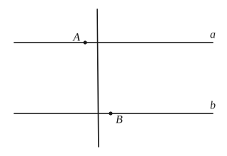
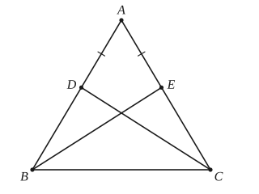
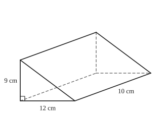

# Đề kiểm tra số 5

**Thời gian làm bài:** 90 phút. **Thang điểm:** mỗi câu 1 điểm, tổng 10 điểm.

## Đề bài

**Câu 1 (Số hữu tỉ).** Tính $\left(-\dfrac{2}{3}\right)^2 - \dfrac{1}{2} \cdot \left(-\dfrac{1}{3}\right)$.

**Câu 2 (Giá trị tuyệt đối).** Tìm $x$ biết $\lvert x - 1\rvert = 3$.

**Câu 3 (Dấu hiệu song song).** Đường thẳng $c$ cắt hai đường thẳng $a$, $b$ lần lượt tại $A$ và $B$, tạo thành một cặp góc so le trong cùng bằng $70^\circ$. Hai đường thẳng $a$, $b$ có song song không? Vì sao?

**Câu 4 (Tam giác bằng nhau).** Cho tam giác $ABC$ cân tại $A$. Lấy $D$ trên $AB$, $E$ trên $AC$ sao cho $AD = AE$. Chứng minh $BE = CD$.

**Câu 5 (Xác suất).** Gieo một con xúc xắc cân đối. Tính xác suất của các biến cố: a) “số chấm lớn hơn 4”; b) “không xuất hiện mặt 6 chấm”.

**Câu 6 (Chia tỉ lệ).** Một tam giác có chu vi 72 cm, ba cạnh tỉ lệ với 3, 4, 5. Tính các cạnh.

**Câu 7 (Tỉ lệ thuận).** Cho $y$ tỉ lệ thuận với $x$. Biết $x_1 = 2$, $x_2 = 5$ và $y_2 - y_1 = 9$. Tìm $y_1$, $y_2$.

**Câu 8 (Nghiệm đa thức).** Chứng tỏ $x = 1$ và $x = \dfrac{1}{2}$ là nghiệm của đa thức $A(x) = 2x^2 - 3x + 1$.

**Câu 9 (Tam giác cân).** Một tam giác cân có hai cạnh dài 3 cm và 7 cm. Tính chu vi tam giác.

**Câu 10 (Lăng trụ đứng).** Một lăng trụ đứng tam giác có đáy là tam giác vuông với các cạnh 9 cm, 12 cm, 15 cm, chiều cao lăng trụ 10 cm. Tính diện tích xung quanh và thể tích.

---

## Lời giải chi tiết

### Câu 1
$\dfrac{4}{9} + \dfrac{1}{6} = \dfrac{8}{18} + \dfrac{3}{18} = \dfrac{11}{18}$.

### Câu 2
$x - 1 = 3$ hoặc $x - 1 = -3$: $x = 4$ hoặc $x = -2$.

### Câu 3

*Hình: Hai đường thẳng a, b và đường thẳng c tạo hai góc so le trong bằng nhau.*

Có. Theo dấu hiệu nhận biết: một đường thẳng cắt hai đường thẳng tạo thành một cặp góc so le trong bằng nhau thì hai đường thẳng đó song song.

### Câu 4

*Hình: Tam giác ABC cân tại A, D trên AB, E trên AC với AD = AE.*

$\triangle ABE = \triangle ACD$ (c.g.c: $AB = AC$, $\widehat{A}$ chung, $AE = AD$), nên $BE = CD$.

### Câu 5
a) Mặt 5, 6: $\dfrac{2}{6} = \dfrac{1}{3}$. b) $1 - \dfrac{1}{6} = \dfrac{5}{6}$.

### Câu 6
$\dfrac{a}{3} = \dfrac{b}{4} = \dfrac{c}{5} = \dfrac{72}{12} = 6$: 18 cm, 24 cm, 30 cm.

### Câu 7
$\dfrac{y_1}{2} = \dfrac{y_2}{5} = \dfrac{y_2 - y_1}{3} = 3$: $y_1 = 6$, $y_2 = 15$.

### Câu 8
$A(1) = 2 - 3 + 1 = 0$; $A\left(\dfrac{1}{2}\right) = \dfrac{1}{2} - \dfrac{3}{2} + 1 = 0$.

### Câu 9
Nếu cạnh bên 3 cm: $3 + 3 < 7$, vô lý. Vậy cạnh bên 7 cm, chu vi $7 + 7 + 3 = 17$ (cm).

### Câu 10

*Hình: Lăng trụ đứng tam giác có đáy là tam giác vuông cạnh 9 cm, 12 cm, 15 cm, chiều cao 10 cm.*

$S_{xq} = (9 + 12 + 15) \cdot 10 = 360 \text{ (cm}^2)$. $V = \dfrac{9 \cdot 12}{2} \cdot 10 = 540 \text{ (cm}^3)$.
