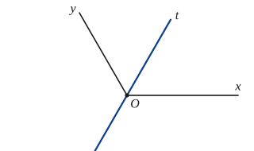
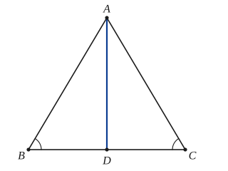

# Đề kiểm tra số 6

**Thời gian làm bài:** 90 phút. **Thang điểm:** mỗi câu 1 điểm, tổng 10 điểm.

## Đề bài

**Câu 1 (Lũy thừa).** Tìm $x$: a) $2^x = 32$; b) $\left(\dfrac{1}{3}\right)^x = \dfrac{1}{81}$.

**Câu 2 (Căn bậc hai).** Tính: a) $\sqrt{0{,}36} + \sqrt{1{,}44}$; b) $\lvert -3{,}5\rvert - \lvert 2\rvert$.

**Câu 3 (Tia phân giác).** Cho $\widehat{xOy} = 120^\circ$, $Ot$ là tia phân giác của $\widehat{xOy}$, $Ot'$ là tia đối của tia $Ot$. Tính $\widehat{xOt}$ và $\widehat{xOt'}$.

**Câu 4 (Tam giác).** Cho tam giác $ABC$ có $\widehat{B} = \widehat{C}$, $AD$ là tia phân giác của góc $A$ ($D \in BC$). Chứng minh $AD \perp BC$ và $BD = DC$.

**Câu 5 (Xác suất).** Lớp 7B có 15 bạn nam và 20 bạn nữ. Chọn ngẫu nhiên một bạn. Tính xác suất bạn được chọn là nam.

**Câu 6 (Dãy tỉ số).** Tìm $x, y$ biết $2x = 3y$ và $x + y = 50$.

**Câu 7 (Tỉ lệ nghịch).** Hai bánh răng ăn khớp nhau, bánh lớn có 40 răng, bánh nhỏ có 24 răng. Khi bánh lớn quay 15 vòng thì bánh nhỏ quay bao nhiêu vòng?

**Câu 8 (Nghiệm đa thức).** a) Tìm nghiệm của $P(x) = x^2 - 4$. b) Chứng tỏ $Q(x) = x^2 + 1$ không có nghiệm.

**Câu 9 (Trọng tâm).** Cho tam giác $ABC$ có trung tuyến $AM$, trọng tâm $G$, biết $GM = 3$ cm. Tính $AM$ và $AG$.

**Câu 10 (Hộp không nắp).** Người ta làm một cái hộp không nắp hình hộp chữ nhật dài 50 cm, rộng 30 cm, cao 20 cm. Tính diện tích vật liệu cần dùng (không tính mép nối).

---

## Lời giải chi tiết

### Câu 1
a) $32 = 2^5$, $x = 5$. b) $\dfrac{1}{81} = \left(\dfrac{1}{3}\right)^4$, $x = 4$.

### Câu 2
a) $0{,}6 + 1{,}2 = 1{,}8$. b) $3{,}5 - 2 = 1{,}5$.

### Câu 3

*Hình: Góc xOy, tia phân giác Ot và tia đối Ot' của Ot.*

$\widehat{xOt} = 60^\circ$. $\widehat{xOt'} = 180^\circ - 60^\circ = 120^\circ$ (kề bù).

### Câu 4

*Hình: Tam giác ABC có góc B bằng góc C, AD là tia phân giác.*

$\widehat{B} = \widehat{C}$ nên tam giác $ABC$ cân tại $A$: $AB = AC$. $\triangle ABD = \triangle ACD$ (c.g.c: $AB = AC$, $\widehat{BAD} = \widehat{CAD}$, $AD$ chung). Suy ra $BD = DC$ và $\widehat{ADB} = \widehat{ADC} = 90^\circ$.

### Câu 5
$\dfrac{15}{35} = \dfrac{3}{7}$.

### Câu 6
$\dfrac{x}{3} = \dfrac{y}{2} = \dfrac{50}{5} = 10$: $x = 30$, $y = 20$.

### Câu 7
Số răng và số vòng tỉ lệ nghịch: $40 \cdot 15 = 24 \cdot n$, $n = 25$ (vòng).

### Câu 8
a) $x^2 = 4$, $x = 2$ hoặc $x = -2$. b) $x^2 + 1 \ge 1 > 0$ với mọi $x$.

### Câu 9
$GM = \dfrac{1}{3}AM$ nên $AM = 9$ cm, $AG = 6$ cm.

### Câu 10
$S_{xq} = 2(50 + 30) \cdot 20 = 3\,200 \text{ (cm}^2)$; đáy $50 \cdot 30 = 1\,500 \text{ (cm}^2)$. Tổng: $4\,700 \text{ cm}^2$.
