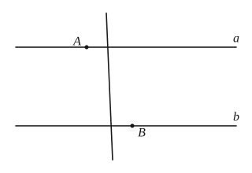
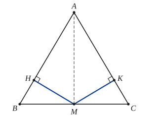
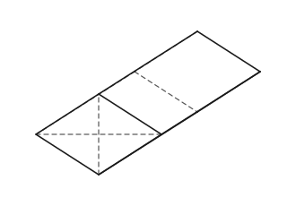

# Đề kiểm tra số 7

**Thời gian làm bài:** 90 phút. **Thang điểm:** mỗi câu 1 điểm, tổng 10 điểm.

## Đề bài

**Câu 1 (Tổng lũy thừa).** Tính $A = 1 + \dfrac{1}{2} + \dfrac{1}{4} + \dfrac{1}{8} + \dfrac{1}{16} + \dfrac{1}{32} + \dfrac{1}{64}$.

**Câu 2 (Căn bậc hai).** Tìm $x$: a) $x^2 = 2{,}25$; b) $\sqrt{x} = 3$.

**Câu 3 (Song song).** Cho $a \parallel b$, đường thẳng $c$ cắt $a$ tại $A$, cắt $b$ tại $B$. Hai góc trong cùng phía tại $A$ và $B$ có số đo là $x$ và $2x$. Tính $x$.

**Câu 4 (Tam giác cân).** Cho tam giác $ABC$ cân tại $A$, $M$ là trung điểm của $BC$. Kẻ $MH \perp AB$, $MK \perp AC$. Chứng minh $MH = MK$.

**Câu 5 (Xác suất).** Tung đồng thời hai đồng xu cân đối. Tính xác suất để cả hai đồng xu đều ngửa.

**Câu 6 (Tỉ lệ thức).** Tìm $x$ biết $\dfrac{x - 1}{4} = \dfrac{9}{x - 1}$.

**Câu 7 (Tỉ lệ nghịch).** Trên cùng một quãng đường, nếu vận tốc tăng thêm 25% thì thời gian đi giảm bao nhiêu phần trăm?

**Câu 8 (Đa thức).** Tìm $m$ để $x = 2$ là nghiệm của $P(x) = x^2 - mx + 6$. Với $m$ vừa tìm, tìm nghiệm còn lại của $P(x)$.

**Câu 9 (Bất đẳng thức tam giác).** Tam giác $ABC$ có $AB = 2$ cm, $BC = 6$ cm, độ dài $AC$ là số nguyên chẵn (cm). Tính $AC$.

**Câu 10 (Lăng trụ đứng).** Một lăng trụ đứng tứ giác có đáy là hình thoi với hai đường chéo 6 cm và 8 cm, cạnh hình thoi 5 cm; chiều cao lăng trụ 10 cm. Tính diện tích xung quanh và thể tích.

---

## Lời giải chi tiết

### Câu 1
$2A = 2 + 1 + \dfrac{1}{2} + \dots + \dfrac{1}{32}$. $2A - A = 2 - \dfrac{1}{64}$, nên $A = \dfrac{127}{64}$.

### Câu 2
a) $x = 1{,}5$ hoặc $x = -1{,}5$. b) $x = 9$.

### Câu 3

*Hình: Hai đường thẳng song song a, b và hai góc trong cùng phía.*

Hai góc trong cùng phía bù nhau: $x + 2x = 180^\circ$, $x = 60^\circ$.

### Câu 4

*Hình: Tam giác ABC cân tại A, M là trung điểm BC, MH vuông góc AB, MK vuông góc AC.*

Hai tam giác vuông $MHB$ và $MKC$ có cạnh huyền $MB = MC$, $\widehat{B} = \widehat{C}$ nên bằng nhau (cạnh huyền – góc nhọn): $MH = MK$.

### Câu 5
Có 4 kết quả SS, SN, NS, NN. $P(\text{NN}) = \dfrac{1}{4}$.

### Câu 6
$(x - 1)^2 = 36$, $x - 1 = 6$ hoặc $x - 1 = -6$: $x = 7$ hoặc $x = -5$.

### Câu 7
Vận tốc mới bằng $\dfrac{5}{4}$ vận tốc cũ nên thời gian mới bằng $\dfrac{4}{5} = 80\%$ thời gian cũ: giảm 20%.

### Câu 8
$4 - 2m + 6 = 0$, $m = 5$. $P(x) = x^2 - 5x + 6 = (x - 2)(x - 3)$, nghiệm còn lại $x = 3$.

### Câu 9
$6 - 2 < AC < 6 + 2$, tức $4 < AC < 8$. Số chẵn: $AC = 6$ cm.

### Câu 10

*Hình: Lăng trụ đứng tứ giác có đáy là hình thoi.*

$S_{xq} = 4 \cdot 5 \cdot 10 = 200 \text{ (cm}^2)$. Diện tích đáy $\dfrac{6 \cdot 8}{2} = 24$, $V = 240 \text{ cm}^3$.
