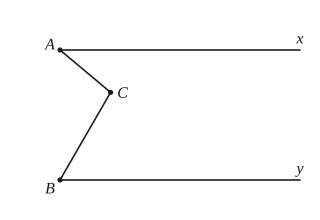
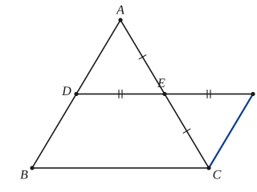

# Đề kiểm tra số 8

**Thời gian làm bài:** 90 phút. **Thang điểm:** mỗi câu 1 điểm, tổng 10 điểm.

## Đề bài

**Câu 1 (Lũy thừa).** Tính $(-0{,}25)^5 \cdot 4^5$.

**Câu 2 (Số thập phân).** a) Viết $\dfrac{5}{12}$ dưới dạng số thập phân. b) Làm tròn $\pi = 3{,}14159\dots$ đến hàng phần trăm.

**Câu 3 (Góc và song song).** Cho hai tia $Ax$ và $By$ song song cùng chiều, điểm $C$ nằm giữa hai đường thẳng chứa hai tia sao cho $\widehat{xAC} = 40^\circ$ và $\widehat{ACB} = 100^\circ$. Tính $\widehat{yBC}$.

**Câu 4 (Tam giác bằng nhau).** Cho tam giác $ABC$, $D$ và $E$ lần lượt là trung điểm của $AB$, $AC$. Trên tia đối của tia $ED$ lấy $F$ sao cho $EF = ED$. Chứng minh $CF = BD$ và $CF \parallel AB$.

**Câu 5 (Xác suất).** Rút ngẫu nhiên một thẻ trong 50 thẻ đánh số từ 1 đến 50. Tính xác suất để số trên thẻ chia hết cho 7.

**Câu 6 (Tỉ lệ thức).** Tìm $x, y$ biết $\dfrac{x}{3} = \dfrac{y}{4}$ và $xy = 48$.

**Câu 7 (Chia tỉ lệ nghịch).** Chia số tiền 2 700 000 đồng cho ba người tỉ lệ nghịch với 2, 3, 6. Tính số tiền mỗi người.

**Câu 8 (Biểu thức).** Chứng tỏ giá trị của biểu thức $(x + 2)(x - 3) - x(x - 1)$ không phụ thuộc vào $x$.

**Câu 9 (Trọng tâm).** Cho tam giác $ABC$ có trọng tâm $G$, diện tích tam giác $GAB$ là $10 \text{ cm}^2$. Tính diện tích tam giác $ABC$.

**Câu 10 (Thể tích).** Một khối gỗ hình lập phương cạnh 6 cm bị khoét một lỗ hình hộp chữ nhật xuyên qua hai mặt đối diện, đáy lỗ là hình vuông cạnh 2 cm. Tính thể tích phần gỗ còn lại.

---

## Lời giải chi tiết

### Câu 1
$(-0{,}25 \cdot 4)^5 = (-1)^5 = -1$.

### Câu 2
a) $0{,}41(6)$. b) $3{,}14$.

### Câu 3

*Hình: Hai tia Ax, By song song cùng chiều và điểm C nằm giữa hai đường thẳng.*

Qua $C$ kẻ $Cz \parallel Ax$ (cùng chiều). $\widehat{ACz} = \widehat{xAC} = 40^\circ$, nên $\widehat{zCB} = 100^\circ - 40^\circ = 60^\circ$. Vì $Cz \parallel By$: $\widehat{yBC} = \widehat{zCB} = 60^\circ$.

### Câu 4

*Hình: Tam giác ABC, D, E là trung điểm AB, AC, F trên tia đối của ED với EF = ED.*

$\triangle ADE = \triangle CFE$ (c.g.c: $EA = EC$, $\widehat{AED} = \widehat{CEF}$, $ED = EF$). Suy ra $CF = AD = BD$ và $\widehat{DAE} = \widehat{FCE}$ (so le trong), nên $CF \parallel AB$.

### Câu 5
Các số chia hết cho 7: 7, 14, …, 49 (7 số). $P = \dfrac{7}{50}$.

### Câu 6
Đặt $x = 3k$, $y = 4k$: $12k^2 = 48$, $k = \pm 2$. $(x; y) = (6; 8)$ hoặc $(-6; -8)$.

### Câu 7
$2a = 3b = 6c$ hay $\dfrac{a}{3} = \dfrac{b}{2} = \dfrac{c}{1} = \dfrac{2\,700\,000}{6} = 450\,000$. Ba người nhận 1 350 000; 900 000; 450 000 (đồng).

### Câu 8
$x^2 - x - 6 - x^2 + x = -6$, không phụ thuộc $x$.

### Câu 9
Trọng tâm chia tam giác thành ba tam giác có diện tích bằng nhau: $S_{ABC} = 3 \cdot 10 = 30 \text{ (cm}^2)$.

### Câu 10
$6^3 - 2 \cdot 2 \cdot 6 = 216 - 24 = 192 \text{ (cm}^3)$.
