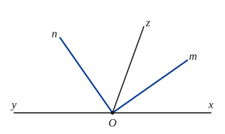
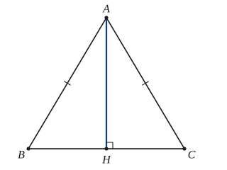
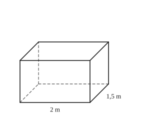

# Đề kiểm tra số 9

**Thời gian làm bài:** 90 phút. **Thang điểm:** mỗi câu 1 điểm, tổng 10 điểm.

## Đề bài

**Câu 1 (Tìm x).** Tìm $x$ biết $\left(x + \dfrac{1}{2}\right)^2 = \dfrac{1}{9}$.

**Câu 2 (Giá trị tuyệt đối).** Tìm $x$ biết $\lvert 2x - 1\rvert = 5$.

**Câu 3 (Hai góc kề bù).** Hai góc kề bù $\widehat{xOz}$ và $\widehat{zOy}$ có hiệu bằng $40^\circ$. Tính hai góc và góc tạo bởi hai tia phân giác của chúng.

**Câu 4 (Tam giác cân).** Cho tam giác $ABC$ cân tại $A$, kẻ $AH \perp BC$. Chứng minh $HB = HC$ và $AH$ là tia phân giác của góc $A$.

**Câu 5 (Xác suất).** Một hộp có 4 bi đỏ và một số bi xanh. Lấy ngẫu nhiên một viên, xác suất lấy được bi đỏ là $\dfrac{2}{5}$. Hộp có bao nhiêu bi xanh?

**Câu 6 (Tỉ lệ thức).** Cho $\dfrac{a}{b} = \dfrac{c}{d}$ (các mẫu khác 0). Chứng minh $\dfrac{2a + 3b}{2c + 3d} = \dfrac{b}{d}$.

**Câu 7 (Tỉ lệ nghịch).** Một ô tô đi từ A đến B với vận tốc 50 km/h hết 6 giờ. Muốn đi hết 5 giờ thì phải đi với vận tốc bao nhiêu?

**Câu 8 (Chia hết đa thức).** Tìm $a$ để $x^3 + ax - 6$ chia hết cho $x - 2$.

**Câu 9 (Bất đẳng thức).** Cho $M$ là điểm nằm trong tam giác $ABC$. Chứng minh $MB + MC < AB + AC$.

**Câu 10 (Bể nước).** Một bể hình hộp chữ nhật đáy 2 m × 1,5 m đang cạn. Một vòi chảy vào bể mỗi phút 30 lít. Sau 1 giờ, mực nước cao bao nhiêu?

---

## Lời giải chi tiết

### Câu 1
$x + \dfrac{1}{2} = \dfrac{1}{3}$ hoặc $-\dfrac{1}{3}$: $x = -\dfrac{1}{6}$ hoặc $x = -\dfrac{5}{6}$.

### Câu 2
$2x - 1 = 5$ hoặc $2x - 1 = -5$: $x = 3$ hoặc $x = -2$.

### Câu 3

*Hình: Hai góc kề bù xOz và zOy với hai tia phân giác.*

$\widehat{xOz} = 110^\circ$, $\widehat{zOy} = 70^\circ$. Góc giữa hai tia phân giác: $55^\circ + 35^\circ = 90^\circ$.

### Câu 4

*Hình: Tam giác ABC cân tại A với đường cao AH.*

Hai tam giác vuông $AHB$, $AHC$ có cạnh huyền $AB = AC$, $AH$ chung nên bằng nhau (cạnh huyền – cạnh góc vuông): $HB = HC$, $\widehat{BAH} = \widehat{CAH}$.

### Câu 5
$\dfrac{4}{\text{tổng}} = \dfrac{2}{5}$, tổng = 10. Số bi xanh: 6.

### Câu 6
Đặt $\dfrac{a}{b} = \dfrac{c}{d} = k$: $\dfrac{2a + 3b}{2c + 3d} = \dfrac{b(2k + 3)}{d(2k + 3)} = \dfrac{b}{d}$ (với $2k + 3 \ne 0$).

### Câu 7
Quãng đường 300 km; vận tốc $300 : 5 = 60$ (km/h).

### Câu 8
$x = 2$ là nghiệm: $8 + 2a - 6 = 0$, $a = -1$.

### Câu 9
Kéo dài $BM$ cắt $AC$ tại $I$. Tam giác $MIC$: $MC < MI + IC$, nên $MB + MC < BI + IC$. Tam giác $ABI$: $BI < AB + AI$, nên $BI + IC < AB + AC$. Vậy $MB + MC < AB + AC$.

### Câu 10

*Hình: Bể nước hình hộp chữ nhật đáy 2 m × 1,5 m.*

Lượng nước: $30 \cdot 60 = 1\,800$ lít $= 1{,}8 \text{ m}^3$. Mực nước: $1{,}8 : 3 = 0{,}6$ (m).
