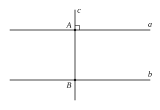
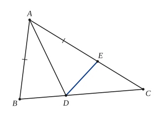
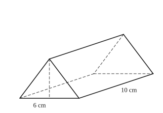

# Đề kiểm tra số 10

**Thời gian làm bài:** 90 phút. **Thang điểm:** mỗi câu 1 điểm, tổng 10 điểm.

## Đề bài

**Câu 1 (Tích phân số).** Tính $A = \left(1 - \dfrac{1}{2}\right)\left(1 - \dfrac{1}{3}\right)\cdots\left(1 - \dfrac{1}{100}\right)$.

**Câu 2 (So sánh).** So sánh $\sqrt{26} + \sqrt{17}$ và 9.

**Câu 3 (Song song, vuông góc).** Cho $a \parallel b$, đường thẳng $c$ vuông góc với $a$ tại $A$ và cắt $b$ tại $B$. Chứng minh $c \perp b$.

**Câu 4 (Tam giác bằng nhau).** Cho tam giác $ABC$ có $AB < AC$, tia phân giác của góc $A$ cắt $BC$ tại $D$. Trên $AC$ lấy $E$ sao cho $AE = AB$. Chứng minh $DE = DB$ và $\widehat{AED} = \widehat{ABC}$.

**Câu 5 (Xác suất).** Gieo đồng thời hai con xúc xắc cân đối. Tính xác suất để tổng số chấm bằng 10.

**Câu 6 (Dãy tỉ số).** Tìm $x, y, z$ biết $\dfrac{x}{3} = \dfrac{y}{4} = \dfrac{z}{5}$ và $x^2 + y^2 + z^2 = 200$.

**Câu 7 (Năng suất).** 10 người làm xong một công việc trong 12 ngày. Làm được 3 ngày thì 5 người nghỉ. Hỏi những người còn lại phải làm tiếp bao nhiêu ngày nữa?

**Câu 8 (Đa thức).** Tìm $a, b$ để đa thức $x^2 + ax + b$ có hai nghiệm $x = 1$ và $x = -2$.

**Câu 9 (Góc và cạnh).** Một tam giác có độ dài ba cạnh là ba số tự nhiên liên tiếp và chu vi bằng 24 cm. Tính các cạnh và cho biết góc lớn nhất đối diện cạnh nào.

**Câu 10 (Lăng trụ đứng).** Một lăng trụ đứng tam giác có đáy là tam giác cân với cạnh đáy 6 cm, hai cạnh bên 5 cm, chiều cao tam giác (ứng với cạnh đáy) 4 cm; chiều cao lăng trụ 10 cm. Tính diện tích xung quanh và thể tích.

---

## Lời giải chi tiết

### Câu 1
$A = \dfrac{1}{2} \cdot \dfrac{2}{3} \cdots \dfrac{99}{100} = \dfrac{1}{100}$.

### Câu 2
$\sqrt{26} > \sqrt{25} = 5$, $\sqrt{17} > \sqrt{16} = 4$, nên tổng lớn hơn 9.

### Câu 3

*Hình: Hai đường thẳng song song a, b và đường thẳng c vuông góc với a.*

Góc tạo bởi $c$ và $a$ tại $A$ bằng $90^\circ$; góc đồng vị tương ứng tại $B$ bằng $90^\circ$ (vì $a \parallel b$). Vậy $c \perp b$.

### Câu 4

*Hình: Tam giác ABC, AD là tia phân giác, E trên AC với AE = AB.*

$\triangle ABD = \triangle AED$ (c.g.c: $AB = AE$, $\widehat{BAD} = \widehat{EAD}$, $AD$ chung). Suy ra $DB = DE$ và $\widehat{ABD} = \widehat{AED}$.

### Câu 5
36 kết quả; tổng 10: $(4; 6), (5; 5), (6; 4)$. $P = \dfrac{3}{36} = \dfrac{1}{12}$.

### Câu 6
Đặt $x = 3k$, $y = 4k$, $z = 5k$: $50k^2 = 200$, $k = \pm 2$. $(6; 8; 10)$ hoặc $(-6; -8; -10)$.

### Câu 7
Công việc cần $120$ ngày công; sau 3 ngày còn $90$ ngày công; 5 người làm tiếp $90 : 5 = 18$ (ngày).

### Câu 8
$1 + a + b = 0$ và $4 - 2a + b = 0$. Trừ hai đẳng thức: $3a - 3 = 0$, $a = 1$, $b = -2$.

### Câu 9
Ba cạnh $n - 1, n, n + 1$ có tổng $3n = 24$, $n = 8$: 7 cm, 8 cm, 9 cm. Góc lớn nhất đối diện cạnh 9 cm.

### Câu 10

*Hình: Lăng trụ đứng tam giác có đáy là tam giác cân.*

$S_{xq} = (6 + 5 + 5) \cdot 10 = 160 \text{ (cm}^2)$. Diện tích đáy $\dfrac{6 \cdot 4}{2} = 12$, $V = 120 \text{ cm}^3$.
