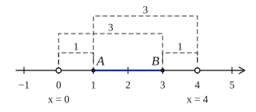

# Chủ đề 2. Giá trị tuyệt đối

> Bài tìm $x$ chứa dấu giá trị tuyệt đối và bài tìm giá trị lớn nhất, nhỏ nhất của biểu thức chứa giá trị tuyệt đối có mặt trong hầu hết đề HSG lớp 7. Chủ đề này dạy cách bỏ dấu giá trị tuyệt đối đúng, và cách dùng bất đẳng thức $\lvert a\rvert + \lvert b\rvert \ge \lvert a + b\rvert$.

## I. Kiến thức cần nắm

> **Ý tưởng xuyên suốt:** $\lvert x - a\rvert$ là **khoảng cách** từ điểm $x$ đến điểm $a$ trên trục số. Nhiều bài khó trở nên dễ khi nhìn theo cách này.

### 1. Định nghĩa và tính chất
$$\lvert x\rvert = \begin{cases} x & \text{nếu } x \ge 0,\\ -x & \text{nếu } x < 0.\end{cases}$$
Tính chất (suy ra trực tiếp từ định nghĩa):
- $\lvert x\rvert \ge 0$; $\lvert x\rvert = 0 \iff x = 0$.
- $\lvert -x\rvert = \lvert x\rvert$; $\lvert x - y\rvert = \lvert y - x\rvert$.
- $\lvert x\rvert \ge x$ và $\lvert x\rvert \ge -x$.
- $\lvert xy\rvert = \lvert x\rvert\cdot\lvert y\rvert$; $\lvert x\rvert^2 = x^2$.

### 2. Các dạng tìm $x$ cơ bản
| Dạng | Cách giải |
|---|---|
| $\lvert A\rvert = k$ | Nếu $k < 0$: vô nghiệm. Nếu $k \ge 0$: $A = k$ hoặc $A = -k$ |
| $\lvert A\rvert = \lvert B\rvert$ | $A = B$ hoặc $A = -B$ |
| $\lvert A\rvert = B$ ($B$ chứa $x$) | Điều kiện $B \ge 0$, rồi $A = B$ hoặc $A = -B$; đối chiếu điều kiện |
| $\lvert A\rvert = A$ | $A \ge 0$ |
| $\lvert A\rvert + \lvert B\rvert = 0$ | $A = 0$ và $B = 0$ (tổng hai số không âm bằng $0$) |

*Ví dụ:* $\lvert x - 3\rvert = 2x$. Điều kiện $2x \ge 0$, tức $x \ge 0$. Khi đó $x - 3 = 2x$ cho $x = -3$ (loại); $x - 3 = -2x$ cho $x = 1$ (nhận). Vậy $x = 1$.

### 3. Bỏ dấu giá trị tuyệt đối bằng cách chia khoảng
Khi có nhiều giá trị tuyệt đối, tìm các điểm làm mỗi biểu thức bên trong bằng $0$, chia trục số thành các khoảng. Trên mỗi khoảng, mỗi biểu thức có dấu xác định nên bỏ được dấu giá trị tuyệt đối.

*Ví dụ:* $\lvert x - 1\rvert + \lvert x - 3\rvert$ bằng
- $4 - 2x$ khi $x < 1$;
- $2$ khi $1 \le x \le 3$;
- $2x - 4$ khi $x > 3$.

**Chú ý:** nghiệm tìm được trong khoảng nào phải **thuộc khoảng đó** mới nhận.

### 4. Bất đẳng thức giá trị tuyệt đối
$$\boxed{\lvert a\rvert + \lvert b\rvert \ge \lvert a + b\rvert}, \quad \text{dấu "=" khi } ab \ge 0.$$
*Chứng minh:* từ $a \le \lvert a\rvert$ và $b \le \lvert b\rvert$ có $a + b \le \lvert a\rvert + \lvert b\rvert$. Từ $-a \le \lvert a\rvert$ và $-b \le \lvert b\rvert$ có $-(a + b) \le \lvert a\rvert + \lvert b\rvert$. Mà $\lvert a + b\rvert$ bằng $a + b$ hoặc $-(a + b)$, nên $\lvert a + b\rvert \le \lvert a\rvert + \lvert b\rvert$. Dấu "=" xảy ra khi $a$, $b$ cùng không âm hoặc cùng không dương, tức là $ab \ge 0$.

**Hệ quả:** $\lvert a\rvert - \lvert b\rvert \le \lvert a - b\rvert$, dấu "=" khi $(a - b)b \ge 0$.
*Chứng minh:* áp dụng bất đẳng thức trên cho hai số $a - b$ và $b$: $\lvert a - b\rvert + \lvert b\rvert \ge \lvert a\rvert$.

### 5. Giá trị lớn nhất, nhỏ nhất
- $\lvert A\rvert + m \ge m$, nên $\lvert A\rvert + m$ có GTNN là $m$, khi $A = 0$.
- $m - \lvert A\rvert \le m$, nên $m - \lvert A\rvert$ có GTLN là $m$, khi $A = 0$.
- **Tổng hai khoảng cách:** với $a < b$,
  $$\lvert x - a\rvert + \lvert x - b\rvert = \lvert x - a\rvert + \lvert b - x\rvert \ge \lvert (x - a) + (b - x)\rvert = b - a,$$
  dấu "=" khi $(x - a)(b - x) \ge 0$, tức là $a \le x \le b$.
- **Tổng nhiều khoảng cách:** $\lvert x - a_1\rvert + \dots + \lvert x - a_n\rvert$ (với $a_1 \le a_2 \le \dots \le a_n$) nhỏ nhất khi $x$ ở **chính giữa**: ghép cặp $a_1$ với $a_n$, $a_2$ với $a_{n-1}$, ... Với $n$ lẻ, $x$ bằng số đứng giữa; với $n$ chẵn, $x$ nằm giữa hai số đứng giữa.

*Ví dụ:* $\lvert x - 1\rvert + \lvert x - 5\rvert \ge 4$, dấu "=" khi $1 \le x \le 5$.

**Ứng dụng giải phương trình:** vì $\lvert x - a\rvert + \lvert x - b\rvert \ge b - a$ luôn đúng, phương trình $\lvert x - a\rvert + \lvert x - b\rvert = b - a$ có nghiệm là **mọi** $x$ với $a \le x \le b$.

### 6. Mẹo "vế phải phải không âm"
Nếu vế trái là tổng các giá trị tuyệt đối (luôn $\ge 0$) và vế phải là $kx$ ($k > 0$), thì $x \ge 0$. Khi biết dấu của $x$, nhiều giá trị tuyệt đối bỏ được ngay.

*Ví dụ:* $\lvert x + 1\rvert + \lvert x + 2\rvert = 3x$. Vế trái không âm nên $x \ge 0$, khi đó $x + 1 > 0$, $x + 2 > 0$, phương trình thành $2x + 3 = 3x$, nên $x = 3$.

### 7. Sai lầm hay gặp
- Viết $\lvert A\rvert = B \Rightarrow A = \pm B$ mà quên điều kiện $B \ge 0$.
- Bỏ dấu giá trị tuyệt đối mà không xét dấu: viết $\lvert x - 5\rvert = x - 5$ với mọi $x$.
- Khi chia khoảng, nhận nghiệm không thuộc khoảng đang xét.
- Viết $\lvert a + b\rvert = \lvert a\rvert + \lvert b\rvert$ với mọi $a$, $b$. Sai, ví dụ $\lvert 3 + (-1)\rvert = 2 \ne 4$.
- Tìm GTNN mà không chỉ ra giá trị của $x$ để dấu "=" xảy ra.

---

## II. Bài tập vận dụng

**Bài 1.** Tìm $x$, biết:
a) $\lvert 2x - 3\rvert = 5$;
b) $\left\lvert x - \frac12\right\rvert + \frac34 = 1$;
c) $\lvert 3x - 1\rvert = \lvert x + 5\rvert$.

**Bài 2.** Tìm $x$, biết:
a) $\lvert x - 2\rvert = 2x - 7$;
b) $\lvert 2x - 1\rvert + 1 - 2x = 0$.

**Bài 3.** Tìm $x$, $y$, biết:
a) $\left\lvert x - \frac13\right\rvert + \lvert 2y + 1\rvert = 0$;
b) $\lvert x + y - 3\rvert + (x - y + 1)^2 = 0$.

**Bài 4.** Tìm giá trị lớn nhất hoặc nhỏ nhất:
a) GTLN của $P = \frac12 - \lvert 3x - 2\rvert$;
b) GTLN của $Q = \frac{6}{\lvert x\rvert + 2}$;
c) GTNN của $R = \lvert x - 1\rvert + \lvert y + 2\rvert - 2025$.

**Bài 5 (chia khoảng).** Tìm $x$, biết $\lvert x - 1\rvert + \lvert x - 3\rvert = 4$.

**Bài 6 (giá trị tuyệt đối lồng nhau).** Tìm $x$, biết $\big\lvert \lvert 2x - 1\rvert - 3\big\rvert = 2$.

**Bài 7.** Tìm $x$, biết $\lvert x + 1\rvert + \lvert x + 2\rvert + \lvert x + 3\rvert = 4x$.

**Bài 8.** Tìm giá trị nhỏ nhất của $A = \lvert x - 2024\rvert + \lvert x - 1\rvert$.

**Bài 9.** Tìm các số nguyên $x$ thỏa mãn $\lvert x + 1\rvert + \lvert x - 4\rvert = 5$.

**Bài 10.** Tìm giá trị lớn nhất và giá trị nhỏ nhất của $B = \lvert x - 2\rvert - \lvert x - 7\rvert$.

**Bài 11 (HSG).** Tìm $x$, biết
$$\left\lvert x + \frac{1}{1\cdot 2}\right\rvert + \left\lvert x + \frac{1}{2\cdot 3}\right\rvert + \dots + \left\lvert x + \frac{1}{99\cdot 100}\right\rvert = 100x.$$

**Bài 12.** Tìm giá trị nhỏ nhất của:
a) $C = \lvert x - 1\rvert + \lvert x - 2\rvert + \lvert x - 3\rvert$;
b) $D = \lvert x - 1\rvert + \lvert x - 2\rvert + \lvert x - 3\rvert + \dots + \lvert x - 100\rvert$.

**Bài 13 (HSG).** Tìm giá trị nhỏ nhất của:
a) $E = \lvert x - 1\rvert + \lvert 2x - 3\rvert$;
b) $F = \lvert x - 2\rvert + \lvert x - 3\rvert + \lvert 2x - 8\rvert$.

---

## III. Lời giải chi tiết

### Bài 1
a) $2x - 3 = 5$ hoặc $2x - 3 = -5$, nên $x = 4$ hoặc $x = -1$.

b) $\left\lvert x - \frac12\right\rvert = 1 - \frac34 = \frac14$. Do đó $x - \frac12 = \frac14$ hoặc $x - \frac12 = -\frac14$, nên $x = \frac34$ hoặc $x = \frac14$.

c) $3x - 1 = x + 5$ hoặc $3x - 1 = -(x + 5)$.
- $2x = 6$, nên $x = 3$.
- $4x = -4$, nên $x = -1$.

Vậy $x = 3$ hoặc $x = -1$.

### Bài 2
a) Điều kiện: $2x - 7 \ge 0$, tức là $x \ge \frac72$.
- $x - 2 = 2x - 7$ cho $x = 5$, thỏa mãn điều kiện.
- $x - 2 = -(2x - 7)$ cho $3x = 9$, $x = 3$, không thỏa mãn vì $3 < \frac72$.

Vậy $x = 5$.

b) Phương trình tương đương $\lvert 2x - 1\rvert = 2x - 1$. Điều này xảy ra khi và chỉ khi $2x - 1 \ge 0$, tức là $x \ge \frac12$.

Vậy mọi $x \ge \frac12$ đều thỏa mãn.

*Nhận xét:* ở câu a, nếu quên điều kiện sẽ nhận sai nghiệm $x = 3$ (thử lại: $\lvert 3 - 2\rvert = 1$ còn $2\cdot 3 - 7 = -1$).

### Bài 3
a) Hai số hạng đều không âm, tổng bằng $0$ nên cả hai bằng $0$: $x - \frac13 = 0$ và $2y + 1 = 0$. Vậy $x = \frac13$, $y = -\frac12$.

b) $\lvert x + y - 3\rvert \ge 0$ và $(x - y + 1)^2 \ge 0$, tổng bằng $0$ nên $x + y = 3$ và $x - y = -1$.
Cộng hai đẳng thức: $2x = 2$, $x = 1$. Suy ra $y = 2$.

### Bài 4
a) $\lvert 3x - 2\rvert \ge 0$ nên $P \le \frac12$. Dấu "=" khi $3x - 2 = 0$, tức là $x = \frac23$. Vậy GTLN của $P$ là $\frac12$, khi $x = \frac23$.

b) $\lvert x\rvert + 2 \ge 2 > 0$ nên $Q = \frac{6}{\lvert x\rvert + 2} \le \frac62 = 3$. Dấu "=" khi $x = 0$. Vậy GTLN của $Q$ là $3$, khi $x = 0$.

c) $\lvert x - 1\rvert \ge 0$ và $\lvert y + 2\rvert \ge 0$ nên $R \ge -2025$. Dấu "=" khi $x = 1$, $y = -2$. Vậy GTNN của $R$ là $-2025$.

### Bài 5

*Hình: Tổng khoảng cách từ $x$ tới $A(1)$ và $B(3)$.*

Các biểu thức $x - 1$ và $x - 3$ đổi dấu tại $x = 1$ và $x = 3$. Xét ba khoảng:
- $x < 1$: phương trình thành $(1 - x) + (3 - x) = 4$, nên $4 - 2x = 4$, $x = 0$. Nhận vì $0 < 1$.
- $1 \le x \le 3$: phương trình thành $(x - 1) + (3 - x) = 4$, tức là $2 = 4$, vô lý.
- $x > 3$: phương trình thành $(x - 1) + (x - 3) = 4$, nên $2x = 8$, $x = 4$. Nhận vì $4 > 3$.

Vậy $x = 0$ hoặc $x = 4$.

*Nhận xét:* trên trục số, đoạn $AB$ dài $2$. Điểm nằm trong đoạn $AB$ luôn có tổng khoảng cách bằng $2$; muốn tổng bằng $4$, điểm phải nằm ngoài đoạn, cách đầu mút gần nhất $\frac{4 - 2}{2} = 1$.

### Bài 6
Từ $\big\lvert \lvert 2x - 1\rvert - 3\big\rvert = 2$ có $\lvert 2x - 1\rvert - 3 = 2$ hoặc $\lvert 2x - 1\rvert - 3 = -2$.
- $\lvert 2x - 1\rvert = 5$: $2x - 1 = 5$ hoặc $2x - 1 = -5$, nên $x = 3$ hoặc $x = -2$.
- $\lvert 2x - 1\rvert = 1$: $2x - 1 = 1$ hoặc $2x - 1 = -1$, nên $x = 1$ hoặc $x = 0$.

Vậy $x \in \{-2; 0; 1; 3\}$.

*Nhận xét:* bỏ dấu giá trị tuyệt đối từ **ngoài vào trong**. Mỗi lần bỏ phải kiểm tra vế phải không âm ($5 \ge 0$ và $1 \ge 0$).

### Bài 7
Vế trái là tổng các số không âm nên $4x \ge 0$, tức là $x \ge 0$.
Khi $x \ge 0$ thì $x + 1$, $x + 2$, $x + 3$ đều dương, phương trình thành
$$(x + 1) + (x + 2) + (x + 3) = 4x \iff 3x + 6 = 4x \iff x = 6.$$
Vậy $x = 6$.

*Nhận xét:* không cần chia bốn khoảng. Dấu của vế phải đã cho biết dấu của $x$.

### Bài 8
$$A = \lvert x - 1\rvert + \lvert 2024 - x\rvert \ge \lvert (x - 1) + (2024 - x)\rvert = 2023.$$
Dấu "=" khi $(x - 1)(2024 - x) \ge 0$, tức là $1 \le x \le 2024$.

Vậy GTNN của $A$ là $2023$, đạt khi $1 \le x \le 2024$.

*Nhận xét:* đổi $\lvert x - 2024\rvert$ thành $\lvert 2024 - x\rvert$ để tổng bên trong không còn $x$. Đây là bước then chốt.

### Bài 9
Ta có $\lvert x + 1\rvert + \lvert x - 4\rvert = \lvert x + 1\rvert + \lvert 4 - x\rvert \ge \lvert (x + 1) + (4 - x)\rvert = 5$.
Dấu "=" xảy ra khi và chỉ khi $(x + 1)(4 - x) \ge 0$, tức là $-1 \le x \le 4$.

Vậy các số nguyên cần tìm là $x \in \{-1; 0; 1; 2; 3; 4\}$, gồm $6$ số.

### Bài 10
Áp dụng $\lvert a\rvert - \lvert b\rvert \le \lvert a - b\rvert$:
$$B = \lvert x - 2\rvert - \lvert x - 7\rvert \le \lvert (x - 2) - (x - 7)\rvert = 5.$$
Tương tự $\lvert x - 7\rvert - \lvert x - 2\rvert \le 5$, nên $B \ge -5$.

Kiểm tra dấu "=":
- Với $x \ge 7$: $B = (x - 2) - (x - 7) = 5$.
- Với $x \le 2$: $B = (2 - x) - (7 - x) = -5$.

Vậy GTLN của $B$ là $5$ (khi $x \ge 7$) và GTNN của $B$ là $-5$ (khi $x \le 2$).

### Bài 11
Vế trái là tổng các số không âm nên $100x \ge 0$, tức là $x \ge 0$. Khi đó mọi biểu thức trong dấu giá trị tuyệt đối đều dương, phương trình thành
$$99x + \left(\frac{1}{1\cdot 2} + \frac{1}{2\cdot 3} + \dots + \frac{1}{99\cdot 100}\right) = 100x.$$
Tổng trong ngoặc bằng $1 - \frac12 + \frac12 - \dots - \frac1{100} = \frac{99}{100}$. Vậy $x = \frac{99}{100}$.

*Nhận xét:* vế trái có $99$ số hạng (mẫu từ $1\cdot 2$ đến $99\cdot 100$), nên phần chứa $x$ là $99x$, không phải $100x$.

### Bài 12
a) $\lvert x - 1\rvert + \lvert x - 3\rvert = \lvert x - 1\rvert + \lvert 3 - x\rvert \ge 2$, dấu "=" khi $1 \le x \le 3$. Ngoài ra $\lvert x - 2\rvert \ge 0$, dấu "=" khi $x = 2$.
Cộng lại: $C \ge 2$. Hai dấu "=" cùng xảy ra khi $x = 2$. Vậy GTNN của $C$ là $2$, khi $x = 2$.

b) Ghép $50$ cặp: $(\lvert x - 1\rvert + \lvert x - 100\rvert)$, $(\lvert x - 2\rvert + \lvert x - 99\rvert)$, ..., $(\lvert x - 50\rvert + \lvert x - 51\rvert)$. Cặp thứ $k$ là $\lvert x - k\rvert + \lvert x - (101 - k)\rvert \ge 101 - 2k$, dấu "=" khi $k \le x \le 101 - k$. Do đó
$$D \ge 99 + 97 + 95 + \dots + 3 + 1.$$
Tổng $50$ số lẻ đầu tiên bằng $\frac{(1 + 99)\cdot 50}{2} = 2500$.
Mọi dấu "=" cùng xảy ra khi $x$ thuộc đoạn nhỏ nhất, tức là $50 \le x \le 51$.

Vậy GTNN của $D$ là $2500$, khi $50 \le x \le 51$.

*Nhận xét:* tổng các khoảng cách từ $x$ tới nhiều điểm nhỏ nhất khi $x$ ở "chính giữa" các điểm đó.

### Bài 13
a) Viết $\lvert 2x - 3\rvert = 2\left\lvert x - \frac32\right\rvert$. Khi đó
$$E = \left(\lvert x - 1\rvert + \left\lvert \tfrac32 - x\right\rvert\right) + \left\lvert x - \tfrac32\right\rvert \ge \frac12 + 0 = \frac12.$$
Dấu "=" khi $1 \le x \le \frac32$ và $x = \frac32$, tức là $x = \frac32$. Thử lại: $E = \frac12 + 0 = \frac12$.

Vậy GTNN của $E$ là $\frac12$, khi $x = \frac32$.

b) Viết $\lvert 2x - 8\rvert = 2\lvert x - 4\rvert$. Khi đó $F$ là tổng khoảng cách từ $x$ tới bốn điểm $2, 3, 4, 4$. Ghép cặp:
- $\lvert x - 2\rvert + \lvert 4 - x\rvert \ge 2$, dấu "=" khi $2 \le x \le 4$;
- $\lvert x - 3\rvert + \lvert 4 - x\rvert \ge 1$, dấu "=" khi $3 \le x \le 4$.

Cộng lại $F \ge 3$, dấu "=" khi $3 \le x \le 4$.

Vậy GTNN của $F$ là $3$, khi $3 \le x \le 4$.

*Nhận xét:* $\lvert kx - m\rvert$ với $k > 0$ được xem như $k$ khoảng cách bằng nhau tới điểm $\frac mk$. Sau đó tìm "điểm giữa" như Bài 12.
