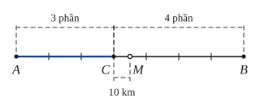

# Chủ đề 4. Đại lượng tỉ lệ, chia tỉ lệ, toán chuyển động và năng suất

> Đề HSG lớp 7 thường có một câu toán có lời văn: chia một đại lượng theo tỉ lệ, bài năng suất, bài chuyển động. Chủ đề này dạy cách nhận ra đại lượng nào tỉ lệ thuận, đại lượng nào tỉ lệ nghịch, rồi đưa bài toán về dãy tỉ số bằng nhau.

## I. Kiến thức cần nắm

> **Ý tưởng xuyên suốt:** trước khi giải, hãy tự hỏi "nếu đại lượng này gấp đôi thì đại lượng kia thế nào?". Gấp đôi theo là **tỉ lệ thuận**, giảm một nửa là **tỉ lệ nghịch**. Sau đó mọi bài đều quy về dãy tỉ số bằng nhau.

### 1. Đại lượng tỉ lệ thuận
$y$ tỉ lệ thuận với $x$ theo hệ số $k$ ($k \ne 0$) nếu $y = kx$. Khi đó $x$ tỉ lệ thuận với $y$ theo hệ số $\frac1k$.

**Tính chất:** với các cặp giá trị tương ứng $(x_1; y_1)$, $(x_2; y_2)$, ...
$$\frac{y_1}{x_1} = \frac{y_2}{x_2} = \dots = k, \qquad \frac{x_1}{x_2} = \frac{y_1}{y_2}.$$

### 2. Đại lượng tỉ lệ nghịch
$y$ tỉ lệ nghịch với $x$ theo hệ số $a$ ($a \ne 0$) nếu $y = \frac ax$, tức là $xy = a$. Khi đó $x$ cũng tỉ lệ nghịch với $y$ theo hệ số $a$.

**Tính chất:**
$$x_1y_1 = x_2y_2 = \dots = a, \qquad \frac{x_1}{x_2} = \frac{y_2}{y_1}.$$

**Nối hai quan hệ:** thuận nối thuận là thuận; nghịch nối nghịch là thuận; thuận nối nghịch là nghịch. Ví dụ $x = 2y$ và $y = \frac{15}{z}$ thì $x = \frac{30}{z}$.

### 3. Chia một số thành các phần tỉ lệ
- **Tỉ lệ thuận với $a, b, c$:** gọi các phần là $x, y, z$ thì $\frac xa = \frac yb = \frac zc$.
- **Tỉ lệ nghịch với $a, b, c$:** $ax = by = cz$, tương đương $x, y, z$ tỉ lệ thuận với $\frac1a, \frac1b, \frac1c$, tức là
  $$\frac{x}{1/a} = \frac{y}{1/b} = \frac{z}{1/c}.$$
  Quy đồng $\frac1a, \frac1b, \frac1c$ để được tỉ lệ thuận với các số nguyên.

*Ví dụ:* tỉ lệ nghịch với $2, 3, 4$ nghĩa là tỉ lệ thuận với $\frac12, \frac13, \frac14 = \frac{6}{12}, \frac{4}{12}, \frac{3}{12}$, tức là tỉ lệ thuận với $6, 4, 3$.

### 4. Toán chuyển động
Công thức $s = v\cdot t$. Từ đó:
- **Cùng quãng đường:** vận tốc và thời gian tỉ lệ nghịch, $\frac{v_1}{v_2} = \frac{t_2}{t_1}$.
- **Cùng thời gian:** quãng đường và vận tốc tỉ lệ thuận, $\frac{s_1}{s_2} = \frac{v_1}{v_2}$. Hai xe xuất phát cùng lúc và gặp nhau thì đi cùng thời gian.
- **Chuyển động trên dòng nước:** $v_{\text{xuôi}} = v_{\text{riêng}} + v_{\text{nước}}$, $v_{\text{ngược}} = v_{\text{riêng}} - v_{\text{nước}}$, nên $v_{\text{xuôi}} - v_{\text{ngược}} = 2v_{\text{nước}}$.

*Ví dụ:* đi với vận tốc $40$ km/h và $60$ km/h trên cùng quãng đường thì thời gian tỉ lệ $60 : 40 = 3 : 2$.

### 5. Toán năng suất và công việc chung
- **Cùng một khối lượng công việc, cùng năng suất:** số người (số máy) và thời gian tỉ lệ nghịch.
- **Cùng thời gian:** khối lượng công việc tỉ lệ thuận với số người.
- **Công việc chung:** nếu một người làm xong công việc trong $a$ giờ thì mỗi giờ làm được $\frac1a$ công việc. Các phần việc trong một giờ **cộng được** khi làm chung.

*Ví dụ:* vòi thứ nhất chảy đầy bể trong $3$ giờ, vòi thứ hai trong $6$ giờ. Mỗi giờ hai vòi chảy được $\frac13 + \frac16 = \frac12$ bể, nên cùng chảy thì đầy bể sau $2$ giờ.

### 6. Các bước giải bài toán có lời văn
1. Gọi ẩn, ghi rõ đơn vị và điều kiện (thường là số dương, có khi là số nguyên).
2. Xác định quan hệ tỉ lệ thuận hay tỉ lệ nghịch, lập dãy tỉ số bằng nhau.
3. Dùng điều kiện còn lại (tổng, hiệu, ...) để tính giá trị chung.
4. Trả lời, kiểm tra điều kiện.

### 7. Sai lầm hay gặp
- Nhầm tỉ lệ nghịch thành tỉ lệ thuận: "tỉ lệ nghịch với $2, 3, 4$" mà viết $\frac x2 = \frac y3 = \frac z4$.
- Cộng thời gian của hai người khi làm chung. Phải cộng **năng suất** (phần việc mỗi giờ), không cộng thời gian.
- Quên đổi đơn vị: phút và giờ, km và m.
- Cho rằng vận tốc trung bình đi và về bằng trung bình cộng hai vận tốc.

---

## II. Bài tập vận dụng

**Bài 1.** Ba lớp 7A, 7B, 7C trồng cây. Số cây của ba lớp tỉ lệ với $3, 4, 5$. Lớp 7C trồng nhiều hơn lớp 7A $24$ cây. Tính số cây mỗi lớp trồng được.

**Bài 2.** Ba đội máy cày cày ba cánh đồng có diện tích bằng nhau. Đội thứ nhất cày xong trong $3$ ngày, đội thứ hai trong $5$ ngày, đội thứ ba trong $6$ ngày. Đội thứ hai nhiều hơn đội thứ ba $1$ máy. Hỏi mỗi đội có bao nhiêu máy? (Năng suất các máy như nhau.)

**Bài 3.** a) Cho $x$ tỉ lệ thuận với $y$ theo hệ số $2$, $y$ tỉ lệ nghịch với $z$ theo hệ số $15$. Hỏi $x$ và $z$ tỉ lệ thuận hay tỉ lệ nghịch, hệ số bao nhiêu?
b) Chứng minh: nếu $x$ tỉ lệ nghịch với $y$ và $y$ tỉ lệ nghịch với $z$ thì $x$ tỉ lệ thuận với $z$.

**Bài 4.** Một ô tô đi từ A đến B với vận tốc $40$ km/h, rồi từ B về A với vận tốc $60$ km/h. Thời gian cả đi và về là $5$ giờ (không kể thời gian nghỉ). Tính quãng đường AB.

**Bài 5.** Một đội $12$ công nhân dự định làm xong một công việc trong $10$ ngày. Làm được $4$ ngày thì đội được bổ sung thêm $6$ công nhân. Hỏi đội làm xong công việc sớm hơn dự định bao nhiêu ngày? (Năng suất mọi người như nhau.)

**Bài 6.** Ba đường cao của một tam giác có độ dài tỉ lệ với $2, 3, 4$. Chu vi tam giác bằng $39$ cm. Tính độ dài ba cạnh.

**Bài 7.** Hai xe khởi hành cùng lúc từ A và B, đi ngược chiều nhau. Vận tốc của xe đi từ A bằng $\frac34$ vận tốc xe đi từ B. Hai xe gặp nhau tại C cách trung điểm M của AB là $10$ km. Tính quãng đường AB.

**Bài 8.** Nếu làm một mình, An làm xong một công việc trong $6$ giờ, Bình làm xong trong $4$ giờ. Cả ba bạn An, Bình, Chi cùng làm thì xong trong $2$ giờ. Hỏi nếu làm một mình thì Chi làm xong công việc đó trong bao lâu?

**Bài 9.** Một ca nô xuôi dòng từ A đến B mất $3$ giờ và ngược dòng từ B về A mất $5$ giờ. Vận tốc dòng nước là $3$ km/h.
a) Tính quãng đường AB.
b) Một khóm bèo trôi theo dòng nước từ A đến B mất bao lâu?

**Bài 10.** Một người dự định đi từ A đến B với vận tốc không đổi. Nếu tăng vận tốc thêm $20\%$ thì đến B sớm hơn dự định $10$ phút. Nếu giảm vận tốc đi $10$ km/h thì đến B muộn hơn dự định $20$ phút. Tính vận tốc dự định và quãng đường AB.

**Bài 11.** Ba người cùng góp vốn kinh doanh: người thứ nhất góp $3$ triệu đồng trong $8$ tháng, người thứ hai góp $4$ triệu đồng trong $9$ tháng, người thứ ba góp $5$ triệu đồng trong $6$ tháng. Tiền lãi $45$ triệu đồng được chia tỉ lệ thuận với tích của số vốn và số tháng góp. Tính tiền lãi của mỗi người.

**Bài 12 (HSG).** Ba lớp 7A, 7B, 7C được giao trồng một số cây. Dự định chia số cây cho ba lớp tỉ lệ với $5, 6, 7$, nhưng sau đó lại chia tỉ lệ với $4, 5, 6$. Vì vậy có một lớp nhận nhiều hơn dự định $4$ cây. Tính tổng số cây và số cây mỗi lớp thực nhận.

**Bài 13 (HSG).** Lúc $4$ giờ đúng, kim giờ và kim phút tạo thành một góc. Hỏi sau ít nhất bao nhiêu phút thì hai kim trùng nhau?

---

## III. Lời giải chi tiết

### Bài 1
Gọi số cây của 7A, 7B, 7C lần lượt là $x, y, z$ (cây, nguyên dương). Theo đề bài $\frac x3 = \frac y4 = \frac z5$ và $z - x = 24$. Theo tính chất dãy tỉ số bằng nhau:
$$\frac x3 = \frac y4 = \frac z5 = \frac{z - x}{5 - 3} = \frac{24}{2} = 12.$$
Vậy $x = 36$, $y = 48$, $z = 60$. Lớp 7A trồng $36$ cây, 7B trồng $48$ cây, 7C trồng $60$ cây.

### Bài 2
Gọi số máy của ba đội là $x, y, z$ (máy, nguyên dương). Cùng diện tích, cùng năng suất thì số máy và số ngày tỉ lệ nghịch: $3x = 5y = 6z$.
Chia các vế cho $30$: $\frac{x}{10} = \frac y6 = \frac z5$. Theo đề $y - z = 1$, nên
$$\frac{x}{10} = \frac y6 = \frac z5 = \frac{y - z}{6 - 5} = 1.$$
Vậy ba đội có lần lượt $10$, $6$, $5$ máy.

### Bài 3
a) $x = 2y$ và $y = \frac{15}{z}$, nên $x = \frac{30}{z}$. Vậy $x$ tỉ lệ nghịch với $z$ theo hệ số $30$.

b) Giả sử $x = \frac ay$ và $y = \frac bz$ ($a, b \ne 0$). Thay vào: $x = \frac{a}{b/z} = \frac ab\cdot z$. Vậy $x$ tỉ lệ thuận với $z$ theo hệ số $\frac ab$.

### Bài 4
Gọi thời gian đi và về là $t_1$, $t_2$ (giờ). Trên cùng quãng đường AB, vận tốc và thời gian tỉ lệ nghịch:
$$40t_1 = 60t_2 \Rightarrow \frac{t_1}{3} = \frac{t_2}{2} = \frac{t_1 + t_2}{5} = \frac55 = 1.$$
Vậy $t_1 = 3$ giờ, và $AB = 40\cdot 3 = 120$ km.

*Nhận xét:* vận tốc trung bình cả đi và về là $\frac{240}{5} = 48$ km/h, không phải $\frac{40 + 60}{2} = 50$ km/h.

### Bài 5
Sau $4$ ngày, phần việc còn lại bằng phần việc $12$ người làm trong $10 - 4 = 6$ ngày.
Gọi $x$ là số ngày $18$ người làm xong phần còn lại. Cùng khối lượng công việc thì số người và số ngày tỉ lệ nghịch:
$$12\cdot 6 = 18\cdot x \Rightarrow x = 4.$$
Tổng thời gian là $4 + 4 = 8$ ngày, sớm hơn dự định $10 - 8 = 2$ ngày.

### Bài 6
Gọi ba cạnh là $a, b, c$ (cm) và ba đường cao tương ứng là $h_a, h_b, h_c$. Diện tích $S$ của tam giác thỏa mãn
$$a\cdot h_a = b\cdot h_b = c\cdot h_c = 2S,$$
nên cạnh và đường cao tương ứng tỉ lệ nghịch. Với $h_a : h_b : h_c = 2 : 3 : 4$ ta có $2a = 3b = 4c$. Chia cho $12$:
$$\frac a6 = \frac b4 = \frac c3 = \frac{a + b + c}{13} = \frac{39}{13} = 3.$$
Vậy ba cạnh là $18$ cm, $12$ cm, $9$ cm. (Ba số này thỏa mãn bất đẳng thức tam giác: $12 + 9 > 18$.)

### Bài 7

*Hình: Quãng đường AB chia thành $7$ phần bằng nhau.*

Hai xe đi cùng thời gian nên quãng đường tỉ lệ thuận với vận tốc. Vận tốc tỉ lệ $3 : 4$ nên $\frac{AC}{3} = \frac{BC}{4}$.
Chia AB thành $7$ phần bằng nhau thì $AC = 3$ phần, $BC = 4$ phần, và trung điểm M cách A $3{,}5$ phần. Do đó $MC = 0{,}5$ phần $= 10$ km, nên một phần dài $20$ km.

Vậy $AB = 7\cdot 20 = 140$ km.

### Bài 8
Mỗi giờ An làm được $\frac16$ công việc, Bình làm được $\frac14$ công việc, cả ba làm được $\frac12$ công việc.
Mỗi giờ Chi làm được
$$\frac12 - \frac16 - \frac14 = \frac{6 - 2 - 3}{12} = \frac1{12} \text{ công việc}.$$
Vậy Chi làm một mình thì xong trong $12$ giờ.

*Nhận xét:* trừ năng suất, không trừ thời gian. Viết $2 - 6 - 4$ là vô nghĩa.

### Bài 9
a) Trên cùng quãng đường AB, vận tốc xuôi và vận tốc ngược tỉ lệ nghịch với thời gian: $3v_x = 5v_n$, nên $\frac{v_x}{5} = \frac{v_n}{3}$.
Mặt khác $v_x - v_n = 2\cdot 3 = 6$ (km/h). Do đó
$$\frac{v_x}{5} = \frac{v_n}{3} = \frac{v_x - v_n}{2} = 3.$$
Vậy $v_x = 15$ km/h và $AB = 15\cdot 3 = 45$ km.

b) Khóm bèo trôi với vận tốc dòng nước $3$ km/h, nên mất $45 : 3 = 15$ giờ.

### Bài 10
Gọi vận tốc dự định là $v$ (km/h) và thời gian dự định là $t$ (phút).

**Điều kiện thứ nhất.** Vận tốc mới bằng $\frac65 v$. Cùng quãng đường nên thời gian mới bằng $\frac56 t$. Thời gian giảm $t - \frac56 t = \frac t6 = 10$ phút, nên $t = 60$ phút $= 1$ giờ. Vậy $AB = v$ (km).

**Điều kiện thứ hai.** Với vận tốc $v - 10$, thời gian là $60 + 20 = 80$ phút $= \frac43$ giờ. Cùng quãng đường nên
$$v\cdot 1 = (v - 10)\cdot\frac43 \iff 3v = 4v - 40 \iff v = 40.$$
Vậy vận tốc dự định là $40$ km/h và $AB = 40$ km.

*Nhận xét:* tăng vận tốc thêm $20\%$, tức là nhân với $\frac65$, thì thời gian nhân với $\frac56$, tức là giảm $\frac16$, **không phải** giảm $20\%$.

### Bài 11
Tích vốn và số tháng của ba người: $3\cdot 8 = 24$, $4\cdot 9 = 36$, $5\cdot 6 = 30$. Gọi tiền lãi của ba người là $x, y, z$ (triệu đồng):
$$\frac{x}{24} = \frac{y}{36} = \frac{z}{30} = \frac{x + y + z}{90} = \frac{45}{90} = \frac12.$$
Vậy ba người nhận lần lượt $12$, $18$, $15$ triệu đồng.

### Bài 12
Gọi tổng số cây là $N$.
- Dự định: 7A, 7B, 7C nhận $\frac{5N}{18}$, $\frac{6N}{18}$, $\frac{7N}{18}$.
- Thực tế: nhận $\frac{4N}{15}$, $\frac{5N}{15}$, $\frac{6N}{15}$.

So sánh từng lớp (quy đồng mẫu $90$):
- 7A: $\frac{25N}{90}$ và $\frac{24N}{90}$, nhận ít hơn.
- 7B: $\frac{30N}{90}$ và $\frac{30N}{90}$, không đổi.
- 7C: $\frac{35N}{90}$ và $\frac{36N}{90}$, nhận nhiều hơn $\frac{N}{90}$.

Vậy lớp nhận nhiều hơn là 7C, và $\frac{N}{90} = 4$, nên $N = 360$.
Số cây thực nhận: 7A nhận $\frac{4\cdot 360}{15} = 96$ cây, 7B nhận $120$ cây, 7C nhận $144$ cây.

*Nhận xét:* đề không nói lớp nào nhận nhiều hơn. Phải so sánh cả ba lớp để tìm ra lớp đó.

### Bài 13
Đo vị trí các kim bằng số **vạch phút** trên mặt đồng hồ ($60$ vạch một vòng). Lúc $4$ giờ, kim phút ở vạch $0$, kim giờ ở vạch $20$.
Trong cùng thời gian, quãng đường hai kim đi tỉ lệ thuận với vận tốc. Kim phút đi $60$ vạch mỗi giờ, kim giờ đi $5$ vạch mỗi giờ, nên quãng đường của kim giờ bằng $\frac1{12}$ quãng đường của kim phút.

Gọi $x$ là số vạch kim phút đi được đến lúc trùng nhau. Khi đó kim giờ đi được $\frac{x}{12}$ vạch, và
$$x = 20 + \frac{x}{12} \iff \frac{11x}{12} = 20 \iff x = \frac{240}{11} = 21\tfrac{9}{11}.$$
Kim phút đi $1$ vạch mỗi phút, nên sau $21\frac{9}{11}$ phút hai kim trùng nhau, tức là lúc $4$ giờ $21\frac9{11}$ phút.

*Nhận xét:* bài đồng hồ là bài "đuổi nhau": kim phút đuổi kim giờ, khoảng cách ban đầu $20$ vạch, mỗi phút rút ngắn $1 - \frac1{12} = \frac{11}{12}$ vạch.
