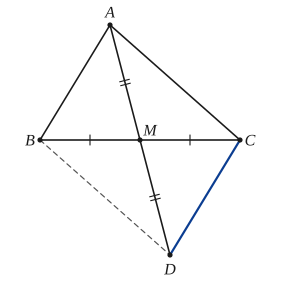
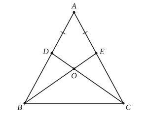
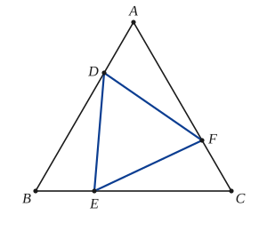
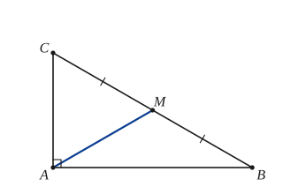
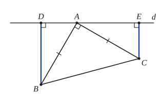
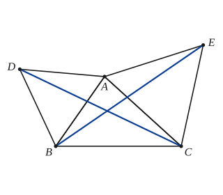
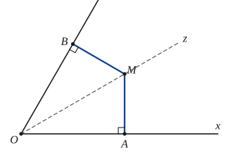
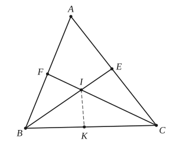
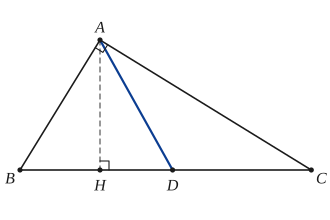
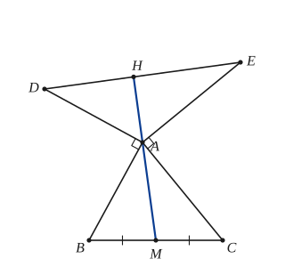

# Chủ đề 8. Tam giác bằng nhau nâng cao: kẻ đường phụ

> Bài hình học trong đề học sinh giỏi lớp 7 thường không cho sẵn hai tam giác bằng nhau. Ta phải **kẻ thêm đường phụ** để tạo ra chúng: nhân đôi trung tuyến, dựng tam giác đều, kẻ đường vuông góc, lấy điểm trên cạnh để có đoạn bằng nhau. Chủ đề này hệ thống các kiểu đường phụ hay dùng.

## I. Kiến thức cần nắm

### 1. Nhắc lại công cụ

- Ba trường hợp bằng nhau c.c.c, c.g.c, g.c.g; các trường hợp của tam giác vuông (cạnh huyền – góc nhọn, cạnh huyền – cạnh góc vuông).
- Tam giác cân, tam giác đều; tổng ba góc; góc ngoài tam giác.
- Hai góc **cùng phụ** (hoặc cùng bù) với một góc thì bằng nhau.

### 2. Các kiểu đường phụ thường gặp

- **Nhân đôi trung tuyến:** $M$ là trung điểm $BC$, lấy $D$ trên tia đối của tia $MA$ sao cho $MD = MA$. Khi đó $\triangle AMB = \triangle DMC$, nên $CD = AB$ và $CD \parallel AB$. Dùng khi đề bài có trung điểm.
- **Lấy đoạn bằng nhau trên cạnh:** đề có phân giác hoặc cần so sánh hai cạnh, lấy điểm $E$ trên cạnh dài sao cho $AE$ bằng cạnh ngắn.
- **Kẻ đường vuông góc:** tạo các tam giác vuông để dùng trường hợp cạnh huyền – góc nhọn.
- **Dựng tam giác đều:** đề có góc $60^\circ$, $30^\circ$, $120^\circ$.
- **Kẻ tia phân giác** của một góc $120^\circ$ để có hai góc $60^\circ$.

### 3. Tính chất hay dùng

- Trong tam giác vuông có một góc $30^\circ$, cạnh góc vuông đối diện góc $30^\circ$ bằng nửa cạnh huyền.
- Trong tam giác vuông, trung tuyến ứng với cạnh huyền bằng nửa cạnh huyền.
- Điểm trên tia phân giác của một góc cách đều hai cạnh của góc.

### 4. Sai lầm hay gặp

- Kẻ đường phụ mà không nói rõ cách dựng (điểm nào, trên tia nào, bằng đoạn nào).
- Dùng tính chất chưa được chứng minh ở lớp 7 (như tính chất đường trung bình) mà không chứng minh lại.
- Kết luận song song mà không chỉ ra cặp góc so le trong (hoặc đồng vị) bằng nhau.

## II. Bài tập vận dụng

**Bài 1 (nhân đôi trung tuyến).** Cho tam giác $ABC$, $M$ là trung điểm của $BC$. Trên tia đối của tia $MA$ lấy điểm $D$ sao cho $MD = MA$. Chứng minh $AB = CD$ và $AB \parallel CD$.

**Bài 2.** Với hình của bài 1, chứng minh $AM < \dfrac{AB + AC}{2}$.

**Bài 3.** Cho tam giác $ABC$ cân tại $A$. Lấy $D$ trên $AB$, $E$ trên $AC$ sao cho $AD = AE$. $BE$ cắt $CD$ tại $O$. Chứng minh $BE = CD$ và $OB = OC$.

**Bài 4.** Cho tam giác đều $ABC$. Trên các cạnh $AB$, $BC$, $CA$ lấy các điểm $D$, $E$, $F$ sao cho $AD = BE = CF$. Chứng minh tam giác $DEF$ đều.

**Bài 5.** Cho tam giác $ABC$ vuông tại $A$ có $\widehat{B} = 30^\circ$. Chứng minh $AC = \dfrac{BC}{2}$.

**Bài 6.** Cho tam giác $ABC$ vuông cân tại $A$. Qua $A$ kẻ đường thẳng $d$ không cắt đoạn $BC$. Kẻ $BD \perp d$, $CE \perp d$ ($D, E \in d$). Chứng minh $DE = BD + CE$.

**Bài 7.** Cho tam giác $ABC$. Dựng ra phía ngoài tam giác các tam giác đều $ABD$ và $ACE$. Chứng minh $BE = CD$.

**Bài 8.** Cho tam giác $ABC$ vuông cân tại $A$, $M$ là trung điểm của $BC$. Chứng minh $AM = BM = CM$ và $AM \perp BC$.

**Bài 9.** Cho tam giác $ABC$ có đường cao $AH$. Trên tia đối của tia $HA$ lấy điểm $D$ sao cho $HD = HA$. Chứng minh $\triangle ABC = \triangle DBC$.

**Bài 10.** Cho góc $xOy$, $Oz$ là tia phân giác. Lấy điểm $M$ trên $Oz$, kẻ $MA \perp Ox$, $MB \perp Oy$ ($A \in Ox$, $B \in Oy$). Chứng minh $MA = MB$ và $OA = OB$.

**Bài 11 (khó).** Cho tam giác $ABC$ có $\widehat{A} = 60^\circ$. Các tia phân giác $BE$, $CF$ ($E \in AC$, $F \in AB$) cắt nhau tại $I$. Chứng minh $IE = IF$.

**Bài 12 (khó).** Cho tam giác $ABC$ vuông tại $A$, đường cao $AH$. Tia phân giác của góc $HAC$ cắt $BC$ tại $D$. Chứng minh tam giác $ABD$ cân.

**Bài 13 (khó).** Cho tam giác $ABC$. Dựng ra phía ngoài tam giác các đoạn $AD \perp AB$, $AD = AB$ và $AE \perp AC$, $AE = AC$. Gọi $M$ là trung điểm của $BC$. Chứng minh $DE = 2AM$ và $AM \perp DE$.

---

## III. Lời giải chi tiết

### Bài 1

*Hình: Tam giác ABC, M là trung điểm BC, D trên tia đối của MA với MD = MA.*

Xét $\triangle AMB$ và $\triangle DMC$: $MA = MD$; $\widehat{AMB} = \widehat{DMC}$ (đối đỉnh); $MB = MC$. Vậy $\triangle AMB = \triangle DMC$ (c.g.c).
Suy ra $AB = DC$ và $\widehat{MAB} = \widehat{MDC}$; hai góc này so le trong nên $AB \parallel CD$.

### Bài 2
Trong tam giác $ACD$: $AD < AC + CD = AC + AB$. Mà $AD = 2AM$, nên $2AM < AB + AC$, tức $AM < \dfrac{AB + AC}{2}$.

### Bài 3

*Hình: Tam giác ABC cân tại A, AD = AE, BE cắt CD tại O.*

$\triangle ABE = \triangle ACD$ (c.g.c: $AB = AC$, $\widehat{A}$ chung, $AE = AD$), nên $BE = CD$ và $\widehat{ABE} = \widehat{ACD}$.
$\widehat{ABC} = \widehat{ACB}$, trừ đi hai góc bằng nhau ở trên: $\widehat{OBC} = \widehat{OCB}$. Tam giác $OBC$ cân tại $O$: $OB = OC$.

### Bài 4

*Hình: Tam giác đều ABC và các điểm D, E, F với AD = BE = CF.*

$BD = AB - AD$, $CE = BC - BE$, $AF = CA - CF$ nên $BD = CE = AF$.
Xét $\triangle ADF$, $\triangle BED$, $\triangle CFE$: $AD = BE = CF$; $\widehat{A} = \widehat{B} = \widehat{C} = 60^\circ$; $AF = BD = CE$. Ba tam giác bằng nhau (c.g.c), nên $DF = ED = FE$: tam giác $DEF$ đều.

### Bài 5

*Hình: Tam giác ABC vuông tại A, góc B bằng 30 độ, M là trung điểm BC.*

$\widehat{C} = 60^\circ$. Lấy $M$ trên $BC$ sao cho $\widehat{MAC} = 60^\circ$. Tam giác $AMC$ có hai góc $60^\circ$ nên đều: $AM = MC = AC$.
$\widehat{MAB} = 90^\circ - 60^\circ = 30^\circ = \widehat{B}$, nên tam giác $AMB$ cân tại $M$: $MB = MA$.
Vậy $MB = MC = AC$, $M$ là trung điểm $BC$ và $AC = \dfrac{BC}{2}$.

### Bài 6

*Hình: Tam giác vuông cân ABC tại A, BD và CE vuông góc với đường thẳng d qua A.*

$\widehat{DAB} + \widehat{EAC} = 180^\circ - 90^\circ = 90^\circ$ và $\widehat{DAB} + \widehat{DBA} = 90^\circ$, nên $\widehat{DBA} = \widehat{EAC}$.
Hai tam giác vuông $ADB$ và $CEA$ có cạnh huyền $AB = CA$, $\widehat{DBA} = \widehat{EAC}$, nên bằng nhau (cạnh huyền – góc nhọn). Suy ra $DA = EC$, $BD = AE$.
$DE = DA + AE = CE + BD$.

### Bài 7

*Hình: Tam giác ABC và hai tam giác đều ABD, ACE dựng ra phía ngoài.*

$\widehat{DAC} = \widehat{DAB} + \widehat{BAC} = 60^\circ + \widehat{BAC}$; $\widehat{BAE} = \widehat{BAC} + \widehat{CAE} = \widehat{BAC} + 60^\circ$. Vậy $\widehat{DAC} = \widehat{BAE}$.
$\triangle DAC = \triangle BAE$ (c.g.c: $AD = AB$, $\widehat{DAC} = \widehat{BAE}$, $AC = AE$). Suy ra $CD = BE$.

### Bài 8
$\triangle AMB = \triangle AMC$ (c.c.c) nên $\widehat{AMB} = \widehat{AMC} = 90^\circ$ và $\widehat{BAM} = \widehat{CAM} = 45^\circ$.
Tam giác $AMB$ có $\widehat{B} = 45^\circ = \widehat{BAM}$ nên cân tại $M$: $MA = MB$. Vậy $AM = BM = CM$ và $AM \perp BC$.

### Bài 9
Hai tam giác vuông $AHB$ và $DHB$ có $HA = HD$, $HB$ chung nên bằng nhau (hai cạnh góc vuông): $BA = BD$. Tương tự $CA = CD$.
$\triangle ABC = \triangle DBC$ (c.c.c: $AB = DB$, $AC = DC$, $BC$ chung).

### Bài 10

*Hình: Góc xOy, tia phân giác Oz, M trên Oz, MA vuông góc Ox, MB vuông góc Oy.*

Hai tam giác vuông $OAM$ và $OBM$ có cạnh huyền $OM$ chung, $\widehat{AOM} = \widehat{BOM}$. Vậy bằng nhau (cạnh huyền – góc nhọn): $MA = MB$, $OA = OB$.

### Bài 11

*Hình: Tam giác ABC có góc A bằng 60 độ, phân giác BE và CF cắt nhau tại I, IK là phân giác góc BIC.*

$\widehat{B} + \widehat{C} = 120^\circ$, nên $\widehat{IBC} + \widehat{ICB} = 60^\circ$ và $\widehat{BIC} = 120^\circ$. Do đó $\widehat{BIF} = \widehat{CIE} = 180^\circ - 120^\circ = 60^\circ$.
Kẻ tia phân giác $IK$ của $\widehat{BIC}$ ($K \in BC$): $\widehat{BIK} = \widehat{CIK} = 60^\circ$.
- $\triangle BIF = \triangle BIK$ (g.c.g: $\widehat{FBI} = \widehat{KBI}$, $BI$ chung, $\widehat{BIF} = \widehat{BIK} = 60^\circ$), nên $IF = IK$.
- $\triangle CIE = \triangle CIK$ (g.c.g), nên $IE = IK$.

Vậy $IE = IF$.

### Bài 12

*Hình: Tam giác ABC vuông tại A, đường cao AH, AD là phân giác góc HAC.*

$\widehat{BAH} = \widehat{C}$ (cùng phụ với $\widehat{B}$). $\widehat{HAD} = \widehat{DAC}$ (phân giác).
$\widehat{BAD} = \widehat{BAH} + \widehat{HAD} = \widehat{C} + \widehat{DAC}$.
$\widehat{BDA}$ là góc ngoài tại $D$ của tam giác $ADC$: $\widehat{BDA} = \widehat{C} + \widehat{DAC}$.
Vậy $\widehat{BAD} = \widehat{BDA}$: tam giác $ABD$ cân tại $B$.

### Bài 13

*Hình: Tam giác ABC, AD vuông góc và bằng AB, AE vuông góc và bằng AC, M là trung điểm BC.*

Nhân đôi trung tuyến: lấy $K$ trên tia đối của tia $MA$ với $MK = MA$. Như bài 1: $CK = AB = AD$ và $CK \parallel AB$, nên $\widehat{ACK} = 180^\circ - \widehat{BAC}$ (hai góc trong cùng phía).
$\widehat{DAE} = 360^\circ - 90^\circ - 90^\circ - \widehat{BAC} = 180^\circ - \widehat{BAC}$. Vậy $\widehat{ACK} = \widehat{EAD}$.
$\triangle ACK = \triangle EAD$ (c.g.c: $AC = EA$, $\widehat{ACK} = \widehat{EAD}$, $CK = AD$). Suy ra $AK = ED$, tức $DE = 2AM$; và $\widehat{CAK} = \widehat{AED}$.
Gọi $H$ là giao điểm của $MA$ (kéo dài) với $DE$. $\widehat{HAE} + \widehat{CAK} = 180^\circ - \widehat{CAE} = 90^\circ$, nên $\widehat{HAE} + \widehat{AEH} = 90^\circ$. Tam giác $AHE$ có $\widehat{AHE} = 90^\circ$: $AM \perp DE$.
