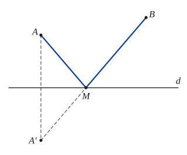
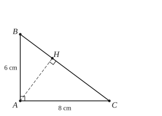
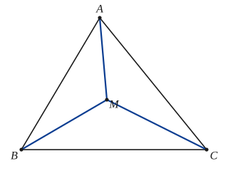
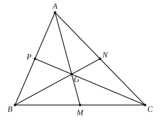
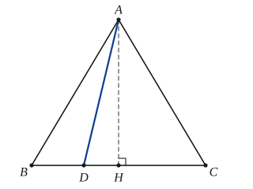

# Chủ đề 9. Quan hệ trong tam giác, bất đẳng thức hình học, định lý Pythagore

> Phần này dùng các quan hệ góc – cạnh, đường vuông góc – đường xiên, bất đẳng thức tam giác để so sánh độ dài và chứng minh bất đẳng thức hình học. Định lý Pythagore (theo chương trình mới học ở lớp 8) vẫn hay xuất hiện trong đề học sinh giỏi lớp 7, nên được trình bày như phần tham khảo.

## I. Kiến thức cần nắm

### 1. Quan hệ góc – cạnh và đường xiên

- Trong tam giác, góc lớn hơn đối diện cạnh lớn hơn.
- Từ một điểm ngoài đường thẳng: đường vuông góc ngắn nhất; đường xiên có hình chiếu lớn hơn thì lớn hơn.

### 2. Bất đẳng thức tam giác và hệ quả

- $\lvert b - c\rvert < a < b + c$.
- Mỗi cạnh nhỏ hơn nửa chu vi.
- **Đường gấp khúc** nối hai điểm luôn dài hơn hoặc bằng đoạn thẳng nối hai điểm đó.
- Trung tuyến $AM$: $\dfrac{\lvert AB - AC\rvert}{2} < AM < \dfrac{AB + AC}{2}$ (nhân đôi trung tuyến rồi dùng bất đẳng thức tam giác).

### 3. Bài toán đường đi ngắn nhất

Hai điểm $A$, $B$ cùng phía đường thẳng $d$. Tìm $M \in d$ sao cho $MA + MB$ nhỏ nhất: lấy $A'$ đối xứng với $A$ qua $d$ ($d$ là trung trực của $AA'$), khi đó $MA = MA'$ và $MA + MB = MA' + MB \ge A'B$. Dấu bằng khi $M$ là giao điểm của $A'B$ với $d$.

### 4. Định lý Pythagore (tham khảo)

- Tam giác $ABC$ vuông tại $A$: $BC^2 = AB^2 + AC^2$.
- **Đảo lại:** nếu $BC^2 = AB^2 + AC^2$ thì tam giác vuông tại $A$.
- Bộ ba số Pythagore hay gặp: $(3, 4, 5)$, $(5, 12, 13)$, $(6, 8, 10)$, $(8, 15, 17)$, $(9, 12, 15)$.
- Tam giác vuông có đường cao $AH$: $AH \cdot BC = AB \cdot AC$ (cùng bằng hai lần diện tích).

### 5. Sai lầm hay gặp

- Dùng Pythagore cho tam giác không vuông.
- Chứng minh bất đẳng thức hình học mà cộng các bất đẳng thức không cùng chiều.
- Bài đường đi ngắn nhất mà nối thẳng $A$ với $B$ (khi $A$, $B$ cùng phía, đoạn $AB$ không cắt $d$).

## II. Bài tập vận dụng

**Bài 1.** Ba cạnh của một tam giác tỉ lệ với 2, 3, 4 và chu vi bằng 45 cm. Tính độ dài các cạnh và cho biết góc nào lớn nhất.

**Bài 2.** Một tam giác có hai cạnh dài 1 cm và 7 cm, độ dài cạnh thứ ba là số nguyên (cm). Tính cạnh thứ ba. Tam giác đó là tam giác gì?

**Bài 3.** Tính cạnh huyền của tam giác vuông có hai cạnh góc vuông dài 5 cm và 12 cm.

**Bài 4.** Tam giác có ba cạnh như sau có phải tam giác vuông không: a) 9 cm, 12 cm, 15 cm; b) 7 cm, 8 cm, 10 cm?

**Bài 5.** Tính độ dài đường chéo của hình vuông cạnh 5 cm (làm tròn đến hàng phần trăm).

**Bài 6.** Hai điểm $A$, $B$ nằm cùng phía đối với đường thẳng $d$. Tìm điểm $M$ trên $d$ sao cho tổng $MA + MB$ nhỏ nhất.

**Bài 7.** Chứng minh rằng trong một tam giác, mỗi cạnh nhỏ hơn nửa chu vi.

**Bài 8.** Cho tam giác $ABC$ vuông tại $A$, $AB = 6$ cm, $AC = 8$ cm, đường cao $AH$. Tính $BC$, $AH$ và $BH$.

**Bài 9.** Từ điểm $A$ nằm ngoài đường thẳng $d$, kẻ $AH \perp d$, $AH = 12$ cm. Hai đường xiên $AB = 13$ cm và $AC = 20$ cm, với $B$, $C$ nằm ở hai phía của $H$. Tính $BC$.

**Bài 10.** Cho điểm $M$ nằm trong tam giác $ABC$. Chứng minh
$$\frac{AB + BC + CA}{2} < MA + MB + MC < AB + BC + CA.$$

**Bài 11.** Cho tam giác $ABC$ có ba trung tuyến $AM$, $BN$, $CP$. Chứng minh tổng ba trung tuyến lớn hơn $\dfrac{3}{4}$ chu vi tam giác.

**Bài 12.** Cho tam giác $ABC$ cân tại $A$ và điểm $D$ nằm trên cạnh $BC$. Chứng minh $AD \le AB$.

**Bài 13 (khó).** Tam giác $ABC$ có $AB = 7$ cm, $AC = 15$ cm, $AM$ là trung tuyến. Chứng minh $4 < AM < 11$ (cm).

**Bài 14 (thực tế).** Một chiếc thang dài 5 m dựa vào tường, chân thang cách chân tường 3 m. a) Đỉnh thang cao bao nhiêu mét? b) Nếu chân thang trượt ra xa tường thêm 1 m thì đỉnh thang tụt xuống bao nhiêu mét?

---

## III. Lời giải chi tiết

### Bài 1
$\dfrac{a}{2} = \dfrac{b}{3} = \dfrac{c}{4} = \dfrac{45}{9} = 5$: ba cạnh 10 cm, 15 cm, 20 cm. Góc lớn nhất là góc đối diện cạnh 20 cm.

### Bài 2
$7 - 1 < c < 7 + 1$, $c = 7$. Tam giác có hai cạnh 7 cm: tam giác cân.

### Bài 3
$\sqrt{5^2 + 12^2} = \sqrt{169} = 13$ (cm).

### Bài 4
a) $9^2 + 12^2 = 81 + 144 = 225 = 15^2$: tam giác vuông.
b) $7^2 + 8^2 = 113 \ne 100 = 10^2$: không vuông.

### Bài 5
Đường chéo là cạnh huyền của tam giác vuông cân cạnh 5 cm: $\sqrt{25 + 25} = \sqrt{50} \approx 7{,}07$ (cm).

### Bài 6

*Hình: Hai điểm A, B cùng phía đường thẳng d, điểm M trên d và A' đối xứng với A qua d.*

Lấy $A'$ sao cho $d$ là đường trung trực của $AA'$. Với mọi $M \in d$: $MA = MA'$, nên $MA + MB = MA' + MB \ge A'B$ (bất đẳng thức tam giác, bằng khi $M$ nằm trên đoạn $A'B$).
Vậy $M$ là giao điểm của đoạn $A'B$ với $d$.

### Bài 7
$a < b + c$; cộng $a$ hai vế: $2a < a + b + c$, tức $a < \dfrac{a + b + c}{2}$. Tương tự với $b$, $c$.

### Bài 8

*Hình: Tam giác ABC vuông tại A, AB = 6 cm, AC = 8 cm, đường cao AH.*

$BC = \sqrt{36 + 64} = 10$ (cm). $AH \cdot BC = AB \cdot AC$ nên $AH = \dfrac{6 \cdot 8}{10} = 4{,}8$ (cm).
$BH^2 = AB^2 - AH^2 = 36 - 23{,}04 = 12{,}96$, $BH = 3{,}6$ (cm).

### Bài 9
$HB = \sqrt{13^2 - 12^2} = 5$ (cm); $HC = \sqrt{20^2 - 12^2} = 16$ (cm). $H$ nằm giữa $B$ và $C$: $BC = 5 + 16 = 21$ (cm).

### Bài 10

*Hình: Điểm M nằm trong tam giác ABC.*

**Vế trái:** trong các tam giác $MAB$, $MBC$, $MCA$: $MA + MB > AB$, $MB + MC > BC$, $MC + MA > CA$. Cộng lại: $2(MA + MB + MC) > AB + BC + CA$.
**Vế phải:** đã biết (chủ đề cơ bản) $MB + MC < AB + AC$; tương tự $MA + MC < BA + BC$, $MA + MB < CA + CB$. Cộng lại: $2(MA + MB + MC) < 2(AB + BC + CA)$.

### Bài 11

*Hình: Tam giác ABC với ba trung tuyến AM, BN, CP.*

Gọi $G$ là trọng tâm: $GB = \dfrac{2}{3}BN$, $GC = \dfrac{2}{3}CP$. Trong tam giác $GBC$: $GB + GC > BC$, tức $\dfrac{2}{3}(BN + CP) > BC$.
Tương tự $\dfrac{2}{3}(AM + CP) > AC$, $\dfrac{2}{3}(AM + BN) > AB$. Cộng lại: $\dfrac{4}{3}(AM + BN + CP) > AB + BC + CA$, tức $AM + BN + CP > \dfrac{3}{4}(AB + BC + CA)$.

### Bài 12

*Hình: Tam giác ABC cân tại A, D trên cạnh BC.*

Kẻ $AH \perp BC$; tam giác cân nên $H$ là trung điểm $BC$. $D$ nằm trên đoạn $BC$ nên $HD \le HB$. Hai đường xiên $AD$, $AB$ có hình chiếu $HD \le HB$, nên $AD \le AB$ (dấu bằng khi $D$ trùng $B$ hoặc $C$).

### Bài 13
Nhân đôi trung tuyến: lấy $D$ với $M$ là trung điểm $AD$; như đã biết $CD = AB = 7$ cm, $AD = 2AM$.
Trong tam giác $ACD$: $AC - CD < AD < AC + CD$, tức $15 - 7 < 2AM < 15 + 7$, $8 < 2AM < 22$. Vậy $4 < AM < 11$.

### Bài 14
a) $\sqrt{5^2 - 3^2} = 4$ (m).
b) Chân thang cách tường 4 m, đỉnh cao $\sqrt{25 - 16} = 3$ (m). Đỉnh thang tụt xuống $4 - 3 = 1$ (m).
