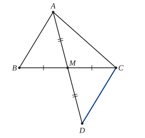
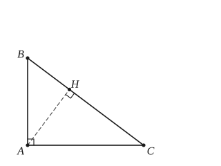

# Đề thi thử số 1

**Thời gian làm bài:** 120 phút. **Thang điểm:** mỗi câu 1 điểm, tổng 10 điểm.

## Đề bài

**Câu 1 (Lũy thừa).** Tính $A = \dfrac{3^{10} \cdot 11 + 3^{10} \cdot 5}{3^9 \cdot 2^4}$.

**Câu 2 (Giá trị tuyệt đối).** Tìm $x$ biết $\lvert x - 2\rvert + \lvert x - 5\rvert = 3$.

**Câu 3 (Dãy tỉ số).** Tìm $x, y, z$ biết $\dfrac{x}{2} = \dfrac{y}{3}$, $\dfrac{y}{4} = \dfrac{z}{5}$ và $x + y - z = 10$.

**Câu 4 (Tỉ lệ nghịch).** Ba đội máy cày ba cánh đồng có diện tích bằng nhau. Đội 1 cày xong trong 4 ngày, đội 2 trong 6 ngày, đội 3 trong 8 ngày. Đội 2 có nhiều hơn đội 3 là 2 máy. Hỏi mỗi đội có bao nhiêu máy (năng suất các máy như nhau)?

**Câu 5 (Đa thức).** Tìm đa thức $f(x) = ax^2 + bx + c$ biết $f(0) = 1$, $f(1) = 2$, $f(-1) = 6$.

**Câu 6 (Số học).** Chứng minh $2^{2025} + 1$ chia hết cho 3.

**Câu 7 (Nghiệm nguyên).** Tìm các cặp số nguyên $(x; y)$ thỏa mãn $xy - x - y = 2$.

**Câu 8 (Tam giác).** Cho tam giác $ABC$, $AM$ là trung tuyến. Chứng minh $AM < \dfrac{AB + AC}{2}$.

**Câu 9 (Pythagore).** Cho tam giác $ABC$ vuông tại $A$, $AB = 9$ cm, $BC = 15$ cm. Tính $AC$ và đường cao $AH$.

**Câu 10 (Xác suất).** Gieo đồng thời hai con xúc xắc cân đối. Tính xác suất để tổng số chấm là một số nguyên tố.

---

## Lời giải chi tiết

### Câu 1
$A = \dfrac{3^{10}(11 + 5)}{3^9 \cdot 16} = \dfrac{3^{10} \cdot 16}{3^9 \cdot 16} = 3$.

### Câu 2
Với mọi $x$: $\lvert x - 2\rvert + \lvert x - 5\rvert \ge \lvert (x - 2) + (5 - x)\rvert = 3$, dấu bằng khi $(x - 2)(5 - x) \ge 0$, tức $2 \le x \le 5$.

**Đáp số:** mọi $x$ thỏa mãn $2 \le x \le 5$.

### Câu 3
$\dfrac{x}{8} = \dfrac{y}{12} = \dfrac{z}{15} = \dfrac{x + y - z}{8 + 12 - 15} = \dfrac{10}{5} = 2$. Vậy $x = 16$, $y = 24$, $z = 30$.

### Câu 4
Số máy tỉ lệ nghịch với số ngày: $4x = 6y = 8z$, hay $\dfrac{x}{6} = \dfrac{y}{4} = \dfrac{z}{3} = \dfrac{y - z}{1} = 2$. Đội 1: 12 máy; đội 2: 8 máy; đội 3: 6 máy.

### Câu 5
$c = 1$; $a + b + 1 = 2$; $a - b + 1 = 6$. Suy ra $a + b = 1$, $a - b = 5$: $a = 3$, $b = -2$. $f(x) = 3x^2 - 2x + 1$.

### Câu 6
$2 = 3 - 1$. Khi khai triển $2^{2025} = (3 - 1)^{2025}$, mọi số hạng chứa 3 đều chia hết cho 3, còn lại $(-1)^{2025} = -1$. Nói cách khác $2^{2025}$ chia 3 dư $-1$ (dư 2), nên $2^{2025} + 1$ chia hết cho 3.

*Cách khác:* $2^{2025} + 1 = 2 \cdot 4^{1012} + 1$; $4^{1012}$ chia 3 dư 1, nên $2 \cdot 4^{1012} + 1$ chia 3 dư $2 + 1 = 3$, tức chia hết.

### Câu 7
$(x - 1)(y - 1) = 3$. $(x - 1; y - 1) \in \{(1; 3), (3; 1), (-1; -3), (-3; -1)\}$.

**Đáp số:** $(2; 4)$, $(4; 2)$, $(0; -2)$, $(-2; 0)$.

### Câu 8

*Hình: Tam giác ABC, trung tuyến AM và điểm D đối xứng với A qua M.*

Lấy $D$ trên tia đối của tia $MA$ với $MD = MA$. $\triangle AMB = \triangle DMC$ (c.g.c) nên $CD = AB$. Trong tam giác $ACD$: $AD < AC + CD = AC + AB$, mà $AD = 2AM$. Vậy $AM < \dfrac{AB + AC}{2}$.

### Câu 9

*Hình: Tam giác ABC vuông tại A, AB = 9 cm, BC = 15 cm, đường cao AH.*

$AC = \sqrt{15^2 - 9^2} = 12$ (cm). $AH = \dfrac{AB \cdot AC}{BC} = \dfrac{9 \cdot 12}{15} = 7{,}2$ (cm).

### Câu 10
36 kết quả. Tổng là số nguyên tố: 2 (1 cách), 3 (2), 5 (4), 7 (6), 11 (2): 15 kết quả. $P = \dfrac{15}{36} = \dfrac{5}{12}$.
