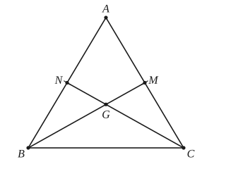
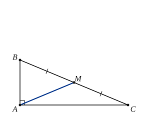

# Đề thi thử số 2

**Thời gian làm bài:** 120 phút. **Thang điểm:** mỗi câu 1 điểm, tổng 10 điểm.

## Đề bài

**Câu 1 (Lũy thừa).** Tính $B = \left(-\dfrac{1}{2}\right)^{2025} \cdot (-2)^{2025}$.

**Câu 2 (Giá trị tuyệt đối).** Tìm $x$ biết $\lvert x + 1\rvert + \lvert x - 3\rvert = 6$.

**Câu 3 (Tỉ lệ thức).** Cho $\dfrac{a}{b} = \dfrac{c}{d}$ (các số khác 0). Chứng minh $\dfrac{a^2 + c^2}{b^2 + d^2} = \dfrac{ac}{bd}$.

**Câu 4 (Chuyển động).** Hai xe đi ngược chiều từ A và B, xuất phát cùng lúc và gặp nhau sau 2 giờ. Vận tốc hai xe tỉ lệ với 3 và 4. Quãng đường $AB$ dài 140 km. Tính vận tốc mỗi xe.

**Câu 5 (Đa thức).** Tìm $a, b$ để đa thức $P(x) = x^3 + ax^2 + bx - 2$ có hai nghiệm $x = 1$ và $x = -1$.

**Câu 6 (Chia hết).** Tìm các số tự nhiên $n$ để $n^2 + 3n + 6$ chia hết cho 5.

**Câu 7 (Nghiệm nguyên).** Tìm các cặp số nguyên dương $(x; y)$ thỏa mãn $\dfrac{1}{x} + \dfrac{1}{y} = \dfrac{1}{3}$.

**Câu 8 (Tam giác cân).** Cho tam giác $ABC$ cân tại $A$, hai trung tuyến $BM$ và $CN$ cắt nhau tại $G$. Chứng minh $BM = CN$ và tam giác $GBC$ cân.

**Câu 9 (Trung tuyến).** Tam giác $ABC$ có $AB = 5$ cm, $AC = 12$ cm, $BC = 13$ cm. Chứng minh tam giác vuông và tính trung tuyến $AM$.

**Câu 10 (Đếm).** Từ các chữ số $0, 1, 2, \dots, 9$ lập được bao nhiêu số có ba chữ số khác nhau chia hết cho 5?

---

## Lời giải chi tiết

### Câu 1
$B = \left[\left(-\dfrac{1}{2}\right)(-2)\right]^{2025} = 1^{2025} = 1$.

### Câu 2
Xét ba khoảng.
- $x < -1$: $-2x + 2 = 6$, $x = -2$ (thỏa).
- $-1 \le x \le 3$: $4 = 6$, vô lý.
- $x > 3$: $2x - 2 = 6$, $x = 4$ (thỏa).

**Đáp số:** $x \in \{-2; 4\}$.

### Câu 3
Đặt $\dfrac{a}{b} = \dfrac{c}{d} = k$: $\dfrac{a^2 + c^2}{b^2 + d^2} = \dfrac{k^2(b^2 + d^2)}{b^2 + d^2} = k^2$ và $\dfrac{ac}{bd} = k \cdot k = k^2$.

### Câu 4
Tổng vận tốc: $140 : 2 = 70$ (km/h). $\dfrac{v_1}{3} = \dfrac{v_2}{4} = 10$: 30 km/h và 40 km/h.

### Câu 5
$P(1) = a + b - 1 = 0$, $P(-1) = a - b - 3 = 0$. Suy ra $a = 2$, $b = -1$.

### Câu 6
Xét $n$ chia 5 dư $r$: $r^2 + 3r + 6$ với $r = 0, 1, 2, 3, 4$ lần lượt chia 5 dư 1, 0, 1, 4, 4.

**Đáp số:** $n$ chia 5 dư 1 ($n = 5k + 1$).

### Câu 7
$3(x + y) = xy$, tức $(x - 3)(y - 3) = 9$. Hai thừa số đều lớn hơn $-3$ nên cùng dương: $(1; 9), (3; 3), (9; 1)$.

**Đáp số:** $(4; 12)$, $(6; 6)$, $(12; 4)$.

### Câu 8

*Hình: Tam giác ABC cân tại A, hai trung tuyến BM và CN cắt nhau tại G.*

$AN = AM$ (nửa hai cạnh bằng nhau). $\triangle ABM = \triangle ACN$ (c.g.c: $AB = AC$, $\widehat{A}$ chung, $AM = AN$) nên $BM = CN$.
$G$ là trọng tâm: $GB = \dfrac{2}{3}BM = \dfrac{2}{3}CN = GC$. Tam giác $GBC$ cân tại $G$.

### Câu 9

*Hình: Tam giác ABC vuông tại A có AB = 5 cm, AC = 12 cm, trung tuyến AM.*

$5^2 + 12^2 = 169 = 13^2$: tam giác vuông tại $A$ (Pythagore đảo). Trung tuyến ứng với cạnh huyền bằng nửa cạnh huyền: $AM = 6{,}5$ cm.

### Câu 10
Tận cùng 0: $9 \cdot 8 = 72$ số. Tận cùng 5: chữ số đầu khác 0 và 5 (8 cách), chữ số giữa 8 cách: 64 số. Tổng: 136 số.
