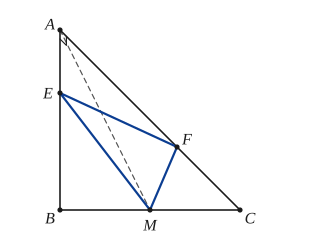
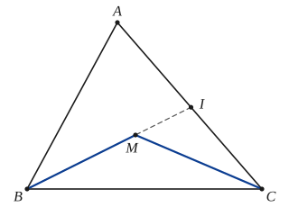

# Đề thi thử số 3

**Thời gian làm bài:** 120 phút. **Thang điểm:** mỗi câu 1 điểm, tổng 10 điểm.

## Đề bài

**Câu 1 (Tổng lũy thừa).** Cho $S = 1 + 3 + 3^2 + \dots + 3^{20}$. Chứng minh $S$ chia hết cho 13.

**Câu 2 (Giá trị nhỏ nhất).** Tìm giá trị nhỏ nhất của $A = \lvert x - 1\rvert + \lvert x - 4\rvert$.

**Câu 3 (Dãy tỉ số).** Tìm $x, y, z$ biết $\dfrac{x}{2} = \dfrac{y}{3} = \dfrac{z}{5}$ và $xyz = 810$.

**Câu 4 (Chuyển động).** Một người dự định đi xe máy từ A đến B hết 3 giờ. Thực tế người đó đi nhanh hơn dự định 10 km/h nên đến sớm 30 phút. Tính quãng đường $AB$.

**Câu 5 (Tổng hệ số).** Tính tổng các hệ số của đa thức $P(x) = (x^2 - 3x + 1)^{2025}$ sau khi khai triển và thu gọn.

**Câu 6 (Số nguyên tố).** Tìm số nguyên tố $p$ sao cho $p + 4$ và $p + 8$ đều là số nguyên tố.

**Câu 7 (Nghiệm nguyên).** Tìm các cặp số nguyên $(x; y)$ thỏa mãn $x^2 + 2y^2 = 9$.

**Câu 8 (Tam giác vuông cân).** Cho tam giác $ABC$ vuông cân tại $A$, $M$ là trung điểm $BC$. Lấy $E$ trên $AB$, $F$ trên $AC$ sao cho $AE = CF$. Chứng minh tam giác $MEF$ vuông cân.

**Câu 9 (So sánh góc).** Cho điểm $M$ nằm trong tam giác $ABC$. Chứng minh $\widehat{BMC} > \widehat{BAC}$.

**Câu 10 (Bất biến).** Trên bảng ghi các số $1, 2, 3, \dots, 10$. Mỗi lần xóa hai số $a, b$ bất kỳ và viết số $a + b - 1$. Sau 9 lần còn lại một số. Số đó là bao nhiêu?

---

## Lời giải chi tiết

### Câu 1
$S$ có 21 số hạng, nhóm 3: $S = (1 + 3 + 9) + 3^3(1 + 3 + 9) + \dots + 3^{18}(1 + 3 + 9) = 13(1 + 3^3 + \dots + 3^{18})$ chia hết cho 13.

### Câu 2
$A \ge \lvert (x - 1) + (4 - x)\rvert = 3$, dấu bằng khi $1 \le x \le 4$. Giá trị nhỏ nhất là 3.

### Câu 3
Đặt $x = 2k$, $y = 3k$, $z = 5k$: $30k^3 = 810$, $k^3 = 27$, $k = 3$. Vậy $x = 6$, $y = 9$, $z = 15$.

### Câu 4
Gọi vận tốc dự định là $v$: $3v = 2{,}5(v + 10)$, $0{,}5v = 25$, $v = 50$. $AB = 150$ km.

### Câu 5
Tổng các hệ số bằng $P(1) = (1 - 3 + 1)^{2025} = (-1)^{2025} = -1$.

### Câu 6
$p = 3$: 7 và 11 nguyên tố. $p = 3k + 1$: $p + 8 = 3(k + 3)$ hợp số. $p = 3k + 2$: $p + 4 = 3(k + 2)$ hợp số. $p = 2$: $p + 4 = 6$ hợp số.

**Đáp số:** $p = 3$.

### Câu 7
$x^2 \le 9$ và $x^2 = 9 - 2y^2$ lẻ nên $x$ lẻ: $x^2 \in \{1; 9\}$. $x^2 = 1$: $y^2 = 4$; $x^2 = 9$: $y = 0$.

**Đáp số:** $(\pm 1; \pm 2)$ (4 cặp) và $(\pm 3; 0)$: 6 cặp.

### Câu 8

*Hình: Tam giác vuông cân ABC tại A, M là trung điểm BC, E trên AB, F trên AC với AE = CF.*

$AM = MC$, $AM \perp BC$, $\widehat{MAB} = \widehat{MCA} = 45^\circ$. $\triangle AME = \triangle CMF$ (c.g.c: $AM = CM$, $\widehat{MAE} = \widehat{MCF}$, $AE = CF$). Suy ra $ME = MF$ và $\widehat{AME} = \widehat{CMF}$, nên $\widehat{EMF} = \widehat{EMA} + \widehat{AMF} = \widehat{CMF} + \widehat{AMF} = \widehat{AMC} = 90^\circ$.

### Câu 9

*Hình: Điểm M nằm trong tam giác ABC, tia BM cắt AC tại I.*

Kéo dài $BM$ cắt $AC$ tại $I$. $\widehat{BMC}$ là góc ngoài của tam giác $MIC$: $\widehat{BMC} > \widehat{MIC}$. $\widehat{MIC}$ (tức $\widehat{BIC}$) là góc ngoài của tam giác $ABI$: $\widehat{BIC} > \widehat{BAI}$. Vậy $\widehat{BMC} > \widehat{BAC}$.

### Câu 10
Gọi $S$ là tổng các số, $n$ là số lượng số. Mỗi lần: $S$ giảm 1, $n$ giảm 1, nên $S - n$ không đổi. Ban đầu $S - n = 55 - 10 = 45$. Cuối cùng còn một số $x$: $x - 1 = 45$, $x = 46$.
