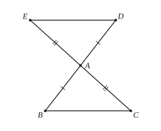
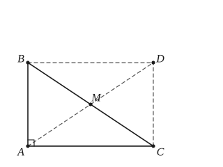

# Đề thi thử số 4

**Thời gian làm bài:** 120 phút. **Thang điểm:** mỗi câu 1 điểm, tổng 10 điểm.

## Đề bài

**Câu 1 (So sánh lũy thừa).** So sánh $2^{225}$ và $3^{150}$.

**Câu 2 (Giá trị tuyệt đối).** Tìm $x$ biết $\lvert x - 3\rvert = 2x + 1$.

**Câu 3 (Tỉ lệ thức).** Tìm $x, y$ biết $\dfrac{x - 1}{2} = \dfrac{y - 2}{3}$ và $2x + 3y = 21$.

**Câu 4 (Chia tỉ lệ nghịch).** Số tiền quyên góp của ba lớp A, B, C tỉ lệ nghịch với 2, 3, 4. Lớp A góp nhiều hơn lớp C 120 000 đồng. Tính số tiền mỗi lớp.

**Câu 5 (Đa thức).** Tìm đa thức bậc hai $P(x)$ biết $P(0) = 3$, $P(1) = 6$, $P(2) = 11$. Chứng minh $P(x)$ không có nghiệm.

**Câu 6 (Chữ số tận cùng).** Tìm chữ số tận cùng của $7^{2025} - 3^{2025}$.

**Câu 7 (Nghiệm tự nhiên).** Tìm các cặp số tự nhiên $(x; y)$ thỏa mãn $2x + 5y = 23$.

**Câu 8 (Tam giác bằng nhau).** Cho tam giác $ABC$. Trên tia đối của tia $AB$ lấy $D$ sao cho $AD = AB$, trên tia đối của tia $AC$ lấy $E$ sao cho $AE = AC$. Chứng minh $BC = DE$ và $BC \parallel DE$.

**Câu 9 (Trung tuyến).** Chứng minh rằng trong tam giác vuông, trung tuyến ứng với cạnh huyền bằng nửa cạnh huyền.

**Câu 10 (Giải đấu).** Mười đội bóng thi đấu vòng tròn một lượt. Thắng được 3 điểm, hòa 1 điểm, thua 0 điểm. Tổng số điểm của các đội là 130. Hỏi có bao nhiêu trận hòa?

---

## Lời giải chi tiết

### Câu 1
$2^{225} = 8^{75}$, $3^{150} = 9^{75}$. Vì $8 < 9$ nên $2^{225} < 3^{150}$.

### Câu 2
Cần $2x + 1 \ge 0$, tức $x \ge -\dfrac{1}{2}$. Khi đó $x - 3 = 2x + 1$ cho $x = -4$ (loại) hoặc $x - 3 = -(2x + 1)$ cho $x = \dfrac{2}{3}$ (thỏa).

**Đáp số:** $x = \dfrac{2}{3}$.

### Câu 3
Đặt $x - 1 = 2k$, $y - 2 = 3k$: $2(2k + 1) + 3(3k + 2) = 13k + 8 = 21$, $k = 1$. Vậy $x = 3$, $y = 5$.

### Câu 4
$2a = 3b = 4c$, hay $\dfrac{a}{6} = \dfrac{b}{4} = \dfrac{c}{3} = \dfrac{a - c}{3} = 40\,000$. Lớp A: 240 000; B: 160 000; C: 120 000 (đồng).

### Câu 5
$P(x) = ax^2 + bx + c$: $c = 3$, $a + b = 3$, $4a + 2b = 8$. Suy ra $a = 1$, $b = 2$: $P(x) = x^2 + 2x + 3 = (x + 1)^2 + 2 \ge 2 > 0$, không có nghiệm.

### Câu 6
$7^{2025}$ tận cùng 7 (chu kỳ 7, 9, 3, 1; $2025$ chia 4 dư 1); $3^{2025}$ tận cùng 3. Hiệu tận cùng là 4.

### Câu 7
$2x = 23 - 5y \ge 0$ và chẵn nên $y$ lẻ, $y \le 4$: $y \in \{1; 3\}$.

**Đáp số:** $(9; 1)$, $(4; 3)$.

### Câu 8

*Hình: Tam giác ABC, D, E trên tia đối của tia AB, AC với AD = AB, AE = AC.*

$\triangle ABC = \triangle ADE$ (c.g.c: $AB = AD$, $\widehat{BAC} = \widehat{DAE}$ đối đỉnh, $AC = AE$). Suy ra $BC = DE$ và $\widehat{ABC} = \widehat{ADE}$ (so le trong), nên $BC \parallel DE$.

### Câu 9

*Hình: Tam giác ABC vuông tại A, M là trung điểm BC, D đối xứng với A qua M.*

Tam giác $ABC$ vuông tại $A$, $M$ trung điểm $BC$. Lấy $D$ đối xứng với $A$ qua $M$. $\triangle AMB = \triangle DMC$ nên $CD = AB$, $CD \parallel AB$; do $AB \perp AC$ nên $CD \perp AC$.
Hai tam giác vuông $BAC$ và $DCA$ có $AB = CD$, $AC$ chung nên bằng nhau: $BC = AD = 2AM$. Vậy $AM = \dfrac{BC}{2}$.

### Câu 10
Có 45 trận. Không có trận hòa thì tổng điểm là 135; mỗi trận hòa giảm 1 điểm. Số trận hòa: $135 - 130 = 5$.
