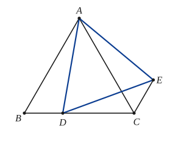
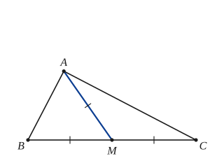
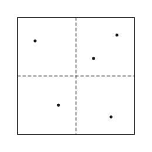

# Đề thi thử số 5

**Thời gian làm bài:** 120 phút. **Thang điểm:** mỗi câu 1 điểm, tổng 10 điểm.

## Đề bài

**Câu 1 (Tổng dãy).** Tính $A = \dfrac{2}{1 \cdot 3} + \dfrac{2}{3 \cdot 5} + \dots + \dfrac{2}{2023 \cdot 2025}$.

**Câu 2 (Giá trị lớn nhất).** Tìm giá trị lớn nhất của $B = 5 - \lvert 2x - 1\rvert$.

**Câu 3 (Tỉ lệ thức).** Cho $\dfrac{a}{b} = \dfrac{b}{c} = \dfrac{c}{d}$ (các số khác 0, $b + c + d \ne 0$). Chứng minh $\left(\dfrac{a + b + c}{b + c + d}\right)^3 = \dfrac{a}{d}$.

**Câu 4 (Chuyển động).** Một vật chuyển động trên bốn cạnh của một hình vuông, lần lượt với vận tốc 5 m/s, 4 m/s, 3 m/s, 2 m/s. Tổng thời gian đi hết bốn cạnh là 77 giây. Tính cạnh hình vuông.

**Câu 5 (Phương trình hàm).** Cho đa thức $f(x)$ thỏa mãn $f(x) + 2f(-x) = x + 3$ với mọi $x$. Tính $f(1)$ và $f(-1)$.

**Câu 6 (Chia hết).** Chứng minh $3^{n + 2} - 2^{n + 2} + 3^n - 2^n$ chia hết cho 10 với mọi số nguyên dương $n$.

**Câu 7 (Nghiệm nguyên).** Tìm các cặp số nguyên $(x; y)$ thỏa mãn $x^2 - xy = 6x - 5y - 8$.

**Câu 8 (Tam giác đều).** Cho tam giác đều $ABC$, điểm $D$ trên cạnh $BC$. Dựng tam giác đều $ADE$ ($E$ và $C$ cùng phía đối với đường thẳng $AD$). Chứng minh $CE \parallel AB$.

**Câu 9 (Trung tuyến).** Cho tam giác $ABC$ có trung tuyến $AM = \dfrac{BC}{2}$. Chứng minh $\widehat{BAC} = 90^\circ$.

**Câu 10 (Dirichlet).** Trong một hình vuông cạnh 2 cm có 5 điểm. Chứng minh có hai điểm cách nhau không quá $\sqrt{2}$ cm.

---

## Lời giải chi tiết

### Câu 1
$\dfrac{2}{n(n + 2)} = \dfrac{1}{n} - \dfrac{1}{n + 2}$. $A = 1 - \dfrac{1}{2025} = \dfrac{2024}{2025}$.

### Câu 2
$\lvert 2x - 1\rvert \ge 0$ nên $B \le 5$, dấu bằng khi $x = \dfrac{1}{2}$. Giá trị lớn nhất là 5.

### Câu 3
Đặt giá trị chung là $k$: $\dfrac{a + b + c}{b + c + d} = k$, nên vế trái bằng $k^3$. Mặt khác $\dfrac{a}{d} = \dfrac{a}{b} \cdot \dfrac{b}{c} \cdot \dfrac{c}{d} = k^3$.

### Câu 4
Thời gian trên cạnh $a$: $a\left(\dfrac{1}{5} + \dfrac{1}{4} + \dfrac{1}{3} + \dfrac{1}{2}\right) = \dfrac{77a}{60} = 77$, $a = 60$ (m).

### Câu 5
$x = 1$: $f(1) + 2f(-1) = 4$. $x = -1$: $f(-1) + 2f(1) = 2$. Giải hệ: $f(1) = 0$, $f(-1) = 2$.

### Câu 6
Biểu thức $= 3^n(9 + 1) - 2^n(4 + 1) = 10 \cdot 3^n - 5 \cdot 2^n = 10 \cdot 3^n - 10 \cdot 2^{n - 1}$ chia hết cho 10.

### Câu 7
$x^2 - 6x + 8 = y(x - 5)$. $x = 5$ không thỏa ($3 = 0$). Vậy $y = \dfrac{x^2 - 6x + 8}{x - 5} = x - 1 + \dfrac{3}{x - 5}$, cần $x - 5 \in \{\pm 1; \pm 3\}$.

**Đáp số:** $(6; 8)$, $(4; 0)$, $(8; 8)$, $(2; 0)$.

### Câu 8

*Hình: Tam giác đều ABC, D trên BC, tam giác đều ADE.*

$\widehat{BAD} = 60^\circ - \widehat{DAC} = \widehat{CAE}$. $\triangle ABD = \triangle ACE$ (c.g.c: $AB = AC$, $\widehat{BAD} = \widehat{CAE}$, $AD = AE$) nên $\widehat{ACE} = \widehat{ABD} = 60^\circ = \widehat{BAC}$. Hai góc $\widehat{ACE}$, $\widehat{BAC}$ so le trong, nên $CE \parallel AB$.

### Câu 9

*Hình: Tam giác ABC có trung tuyến AM bằng nửa BC.*

$MA = MB = MC$ nên các tam giác $MAB$, $MAC$ cân tại $M$: $\widehat{MAB} = \widehat{B}$, $\widehat{MAC} = \widehat{C}$. Do đó $\widehat{BAC} = \widehat{B} + \widehat{C}$. Mà tổng ba góc bằng $180^\circ$ nên $2\widehat{BAC} = 180^\circ$, $\widehat{BAC} = 90^\circ$.

### Câu 10

*Hình: Hình vuông cạnh 2 chia thành bốn hình vuông cạnh 1.*

Chia hình vuông thành 4 hình vuông nhỏ cạnh 1 cm. 5 điểm vào 4 hình nên có hai điểm cùng thuộc một hình vuông nhỏ. Khoảng cách hai điểm trong hình vuông cạnh 1 không vượt quá đường chéo $\sqrt{1 + 1} = \sqrt{2}$ cm.
