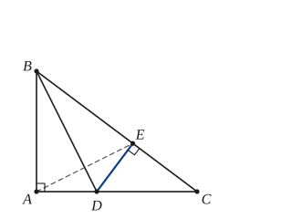
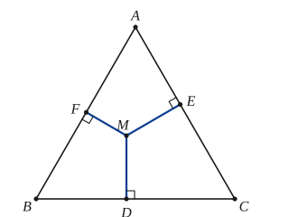

# Đề thi thử số 6

**Thời gian làm bài:** 120 phút. **Thang điểm:** mỗi câu 1 điểm, tổng 10 điểm.

## Đề bài

**Câu 1 (Lũy thừa).** Tìm $x$ biết $3^x + 3^{x + 1} + 3^{x + 2} = 351$.

**Câu 2 (Giá trị nhỏ nhất).** Tìm giá trị nhỏ nhất của $A = \lvert x\rvert + \lvert x - 1\rvert + \lvert x - 2\rvert$.

**Câu 3 (Dãy tỉ số).** Tìm $x, y, z$ biết $3x = 2y$, $7y = 5z$ và $x - y + z = 32$.

**Câu 4 (Chia tỉ lệ).** Số tiền của ba bạn tỉ lệ với 2, 3, 4. Nếu bạn thứ ba cho bạn thứ nhất 20 nghìn đồng thì hai bạn này có số tiền bằng nhau. Tính số tiền mỗi bạn.

**Câu 5 (Chia hết đa thức).** Tìm $a$ để $P(x) = x^4 - 3x^3 + ax - 4$ chia hết cho $x - 2$.

**Câu 6 (Số chính phương).** Tìm số tự nhiên $n$ để $2^n + 7$ là số chính phương.

**Câu 7 (Nghiệm nguyên).** Tìm các cặp số nguyên $(x; y)$ thỏa mãn $3xy + x - y = 1$.

**Câu 8 (Tam giác).** Cho tam giác $ABC$ vuông tại $A$, tia phân giác của góc $B$ cắt $AC$ tại $D$. Kẻ $DE \perp BC$ ($E \in BC$). Chứng minh $BA = BE$, $DA = DE$ và $BD$ là đường trung trực của $AE$.

**Câu 9 (Khoảng cách).** Cho tam giác đều $ABC$ có đường cao $h$ và điểm $M$ bất kỳ nằm trong tam giác. Gọi $MD$, $ME$, $MF$ là khoảng cách từ $M$ đến $BC$, $CA$, $AB$. Chứng minh $MD + ME + MF = h$.

**Câu 10 (Xác suất).** Chọn ngẫu nhiên một số có hai chữ số. Tính xác suất để số đó chia hết cho cả 2 và 3.

---

## Lời giải chi tiết

### Câu 1
$3^x(1 + 3 + 9) = 13 \cdot 3^x = 351$, $3^x = 27$, $x = 3$.

### Câu 2
$\lvert x\rvert + \lvert x - 2\rvert \ge 2$ (dấu bằng khi $0 \le x \le 2$) và $\lvert x - 1\rvert \ge 0$ (bằng khi $x = 1$). $A \ge 2$, dấu bằng khi $x = 1$. Giá trị nhỏ nhất là 2.

### Câu 3
$\dfrac{x}{2} = \dfrac{y}{3}$ hay $\dfrac{x}{10} = \dfrac{y}{15}$; $\dfrac{y}{5} = \dfrac{z}{7}$ hay $\dfrac{y}{15} = \dfrac{z}{21}$. $\dfrac{x}{10} = \dfrac{y}{15} = \dfrac{z}{21} = \dfrac{32}{16} = 2$: $x = 20$, $y = 30$, $z = 42$.

### Câu 4
Đặt $a = 2k$, $b = 3k$, $c = 4k$ (nghìn đồng): $2k + 20 = 4k - 20$, $k = 20$. Ba bạn có 40, 60, 80 nghìn đồng.

### Câu 5
$P(2) = 16 - 24 + 2a - 4 = 0$, $a = 6$.

### Câu 6
$n = 0$: 8, không chính phương. $n = 1$: $9 = 3^2$. $n \ge 2$: $2^n + 7$ chia 4 dư 3, mà số chính phương chia 4 dư 0 hoặc 1.

**Đáp số:** $n = 1$.

### Câu 7
Nhân hai vế với 3: $9xy + 3x - 3y - 1 = 2$, tức $(3x - 1)(3y + 1) = 2$. $3x - 1 \in \{1; 2; -1; -2\}$, chỉ $3x - 1 = 2$ ($x = 1$, $y = 0$) và $3x - 1 = -1$ ($x = 0$, $y = -1$) cho số nguyên.

**Đáp số:** $(1; 0)$, $(0; -1)$.

### Câu 8

*Hình: Tam giác ABC vuông tại A, BD là phân giác góc B, DE vuông góc BC.*

Hai tam giác vuông $ABD$, $EBD$ có cạnh huyền $BD$ chung, $\widehat{ABD} = \widehat{EBD}$ nên bằng nhau: $BA = BE$, $DA = DE$. $B$ và $D$ cùng cách đều $A$, $E$ nên $BD$ là đường trung trực của $AE$.

### Câu 9

*Hình: Tam giác đều ABC và điểm M bên trong cùng các đoạn vuông góc tới ba cạnh.*

Gọi $a$ là cạnh tam giác. $S_{ABC} = S_{MBC} + S_{MCA} + S_{MAB}$, tức $\dfrac{a \cdot h}{2} = \dfrac{a \cdot MD}{2} + \dfrac{a \cdot ME}{2} + \dfrac{a \cdot MF}{2}$. Chia cho $\dfrac{a}{2}$: $MD + ME + MF = h$.

### Câu 10
Số chia hết cho 6 có hai chữ số: 12, 18, …, 96: 15 số. $P = \dfrac{15}{90} = \dfrac{1}{6}$.
