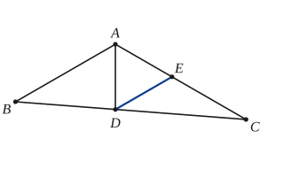

# Đề thi thử số 7

**Thời gian làm bài:** 120 phút. **Thang điểm:** mỗi câu 1 điểm, tổng 10 điểm.

## Đề bài

**Câu 1 (Tổng dãy).** Tính $S = 1 \cdot 2 + 2 \cdot 3 + 3 \cdot 4 + \dots + 99 \cdot 100$.

**Câu 2 (Giá trị tuyệt đối).** Tìm $x$ biết $\lvert x - 1\rvert + \lvert 2 - x\rvert = 3$.

**Câu 3 (Tỉ lệ thức).** Cho $\dfrac{a + b}{a - b} = \dfrac{c + d}{c - d}$ (các mẫu khác 0, $b, d \ne 0$). Chứng minh $\dfrac{a}{b} = \dfrac{c}{d}$.

**Câu 4 (Chuyển động).** Hai ô tô khởi hành cùng lúc từ A và B đi ngược chiều nhau. Sau khi gặp nhau, xe đi từ A phải đi thêm 4 giờ nữa mới đến B, xe đi từ B phải đi thêm 9 giờ nữa mới đến A. Hỏi hai xe gặp nhau sau bao lâu kể từ lúc khởi hành?

**Câu 5 (Đa thức).** Tìm đa thức bậc nhất $P(x)$ biết $P(1) = 3$ và $P(2) = 5$.

**Câu 6 (Số chính phương).** Chứng minh tổng của năm số chính phương liên tiếp không là số chính phương.

**Câu 7 (Nghiệm nguyên).** Tìm số nguyên $x$ để $\dfrac{x^2 + 3}{x - 1}$ là số nguyên.

**Câu 8 (Tam giác đều).** Cho tam giác $ABC$ có $\widehat{A} = 120^\circ$, $AD$ là tia phân giác ($D \in BC$). Qua $D$ kẻ đường thẳng song song với $AB$ cắt $AC$ tại $E$. Chứng minh tam giác $ADE$ đều.

**Câu 9 (Pythagore, trọng tâm).** Tam giác $ABC$ vuông tại $A$ có $AB = 8$ cm, $AC = 6$ cm, $G$ là trọng tâm. Tính $BC$ và $AG$.

**Câu 10 (Trò chơi).** Trên bảng ghi số 2 025. Hai bạn lần lượt trừ số trên bảng đi một số tự nhiên từ 1 đến 9 rồi ghi kết quả thay cho số cũ. Ai đưa được số trên bảng về 0 thì thắng. Người đi trước có cách thắng không?

---

## Lời giải chi tiết

### Câu 1
$3k(k + 1) = k(k + 1)(k + 2) - (k - 1)k(k + 1)$. Cộng với $k = 1, \dots, 99$: $3S = 99 \cdot 100 \cdot 101$, $S = 333\,300$.

### Câu 2
$x < 1$: $3 - 2x = 3$, $x = 0$. $1 \le x \le 2$: $1 = 3$, vô lý. $x > 2$: $2x - 3 = 3$, $x = 3$.

**Đáp số:** $x \in \{0; 3\}$.

### Câu 3
Nhân chéo: $(a + b)(c - d) = (a - b)(c + d)$, khai triển: $ac - ad + bc - bd = ac + ad - bc - bd$, tức $2bc = 2ad$, $ad = bc$, suy ra $\dfrac{a}{b} = \dfrac{c}{d}$.

### Câu 4
Gọi thời gian đến lúc gặp là $t$ giờ, vận tốc hai xe $v_1$, $v_2$. Quãng đường xe B đã đi ($v_2 t$) bằng quãng đường xe A đi tiếp ($4v_1$); quãng đường xe A đã đi ($v_1 t$) bằng $9v_2$. Suy ra $\dfrac{v_1}{v_2} = \dfrac{t}{4} = \dfrac{9}{t}$, nên $t^2 = 36$, $t = 6$ (giờ).

### Câu 5
$P(x) = ax + b$: $a + b = 3$, $2a + b = 5$, nên $a = 2$, $b = 1$: $P(x) = 2x + 1$.

### Câu 6
Năm số chính phương liên tiếp: $(n - 2)^2 + (n - 1)^2 + n^2 + (n + 1)^2 + (n + 2)^2 = 5(n^2 + 2)$. Số chính phương $n^2$ chia 5 dư 0, 1 hoặc 4, nên $n^2 + 2$ chia 5 dư 2, 3 hoặc 1: không chia hết cho 5. Tổng chia hết cho 5 nhưng không chia hết cho 25, nên không là số chính phương.

### Câu 7
$x^2 + 3 = (x - 1)(x + 1) + 4$. Cần $x - 1 \in \{\pm 1; \pm 2; \pm 4\}$.

**Đáp số:** $x \in \{2; 0; 3; -1; 5; -3\}$.

### Câu 8

*Hình: Tam giác ABC có góc A bằng 120 độ, AD là phân giác, DE song song AB.*

$\widehat{DAE} = 60^\circ$. $DE \parallel AB$ nên $\widehat{ADE} = \widehat{BAD} = 60^\circ$ (so le trong). Tam giác $ADE$ có hai góc $60^\circ$ nên là tam giác đều.

### Câu 9
$BC = \sqrt{64 + 36} = 10$ (cm). Trung tuyến $AM = \dfrac{BC}{2} = 5$ cm, $AG = \dfrac{2}{3} \cdot 5 = \dfrac{10}{3}$ (cm).

### Câu 10
Có. Người đi trước trừ 5, còn 2 020 (bội của 10). Sau đó, người kia trừ $k$ thì người đi trước trừ $10 - k$. Số trên bảng luôn là bội của 10 sau lượt của người đi trước, cuối cùng người đi trước đưa về 0.
