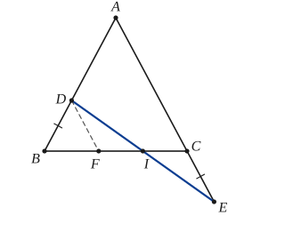
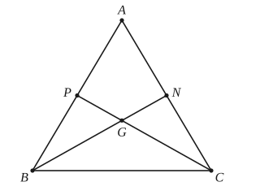

# Đề thi thử số 8

**Thời gian làm bài:** 120 phút. **Thang điểm:** mỗi câu 1 điểm, tổng 10 điểm.

## Đề bài

**Câu 1 (So sánh).** So sánh $A = \dfrac{2025^{2024} + 1}{2025^{2025} + 1}$ và $B = \dfrac{2025^{2023} + 1}{2025^{2024} + 1}$.

**Câu 2 (Giá trị tuyệt đối).** Tìm $x$ biết $\lvert x + 2\rvert + \lvert x - 1\rvert + \lvert x - 4\rvert = 8$.

**Câu 3 (Cấu tạo số).** Tìm số có ba chữ số chia hết cho 18, biết ba chữ số của nó tỉ lệ với 1, 2, 3.

**Câu 4 (Chia tỉ lệ).** Số cây ba đội trồng thỏa mãn: đội 1 và đội 2 tỉ lệ với 2 và 3; đội 2 và đội 3 tỉ lệ với 4 và 5. Đội 3 trồng nhiều hơn đội 1 là 28 cây. Tính số cây mỗi đội.

**Câu 5 (Đa thức vô nghiệm).** Chứng minh đa thức $P(x) = x^8 - x^5 + x^2 - x + 1$ không có nghiệm.

**Câu 6 (Số nguyên tố).** Tìm số nguyên tố $p$ sao cho $8p^2 + 1$ cũng là số nguyên tố.

**Câu 7 (Nghiệm nguyên).** Chứng minh rằng không có số nguyên $x, y$ nào thỏa mãn $x^2 - y^2 = 2026$.

**Câu 8 (Tam giác cân).** Cho tam giác $ABC$ cân tại $A$. Trên cạnh $AB$ lấy $D$, trên tia đối của tia $CA$ lấy $E$ sao cho $BD = CE$. $DE$ cắt $BC$ tại $I$. Chứng minh $ID = IE$.

**Câu 9 (Trung tuyến).** Chứng minh rằng tam giác có hai trung tuyến bằng nhau là tam giác cân.

**Câu 10 (Xác suất).** Rút lần lượt hai thẻ (không hoàn lại) trong năm thẻ ghi các chữ số 1, 2, 3, 4, 5, rồi ghép thành số có hai chữ số (thẻ rút trước là chữ số hàng chục). Tính xác suất để được số chẵn.

---

## Lời giải chi tiết

### Câu 1
$2025A = \dfrac{2025^{2025} + 2025}{2025^{2025} + 1} = 1 + \dfrac{2024}{2025^{2025} + 1}$; $2025B = 1 + \dfrac{2024}{2025^{2024} + 1}$. Mẫu thứ nhất lớn hơn nên $2025A < 2025B$, tức $A < B$.

### Câu 2
Xét các khoảng: $x \ge 4$: $3x - 3 = 8$, $x = \dfrac{11}{3}$ (loại). $1 \le x < 4$: $x + 5 = 8$, $x = 3$. $-2 \le x < 1$: $7 - x = 8$, $x = -1$. $x < -2$: $3 - 3x = 8$, $x = -\dfrac{5}{3}$ (loại).

**Đáp số:** $x \in \{-1; 3\}$.

### Câu 3
Ba chữ số là $a, 2a, 3a$ với $3a \le 9$: bộ $\{1; 2; 3\}$, $\{2; 4; 6\}$, $\{3; 6; 9\}$. Chia hết cho 9: tổng $6a$ chia hết cho 9, nên $a = 3$. Chia hết cho 2: tận cùng là 6.

**Đáp số:** 396 và 936.

### Câu 4
$\dfrac{x}{8} = \dfrac{y}{12} = \dfrac{z}{15} = \dfrac{z - x}{7} = 4$. Đội 1: 32; đội 2: 48; đội 3: 60 cây.

### Câu 5
- $x \le 0$: các số hạng $x^8, -x^5, x^2, -x$ đều không âm, cộng 1 được số dương.
- $0 < x < 1$: $P(x) = x^8 + x^2(1 - x^3) + (1 - x) > 0$.
- $x \ge 1$: $P(x) = x^5(x^3 - 1) + x(x - 1) + 1 > 0$.

Vậy $P(x) > 0$ với mọi $x$, không có nghiệm.

### Câu 6
$p = 3$: $8 \cdot 9 + 1 = 73$ nguyên tố. $p \ne 3$: $p^2$ chia 3 dư 1, nên $8p^2 + 1$ chia 3 dư $8 + 1 = 9$, tức chia hết cho 3 và lớn hơn 3: hợp số.

**Đáp số:** $p = 3$.

### Câu 7
Số chính phương chia 4 dư 0 hoặc 1, nên $x^2 - y^2$ chia 4 dư 0, 1 hoặc 3. Mà 2026 chia 4 dư 2. Vậy không có nghiệm nguyên.

### Câu 8

*Hình: Tam giác ABC cân tại A, D trên AB, E trên tia đối của tia CA với BD = CE, DE cắt BC tại I.*

Kẻ $DF \parallel AC$ ($F \in BC$). Khi đó $\widehat{DFB} = \widehat{ACB} = \widehat{B}$, nên tam giác $DBF$ cân: $DF = DB = CE$.
$\triangle IDF = \triangle IEC$ (g.c.g: $\widehat{IDF} = \widehat{IEC}$ so le trong, $DF = EC$, $\widehat{IFD} = \widehat{ICE}$ so le trong). Suy ra $ID = IE$.

### Câu 9

*Hình: Tam giác ABC có hai trung tuyến BN và CP bằng nhau cắt nhau tại G.*

$G$ là trọng tâm: $GB = \dfrac{2}{3}BN = \dfrac{2}{3}CP = GC$ và $GN = GP$. $\triangle GBP = \triangle GCN$ (c.g.c: $GB = GC$, góc đối đỉnh, $GP = GN$) nên $BP = CN$, tức $\dfrac{AB}{2} = \dfrac{AC}{2}$: $AB = AC$.

### Câu 10
Có $5 \cdot 4 = 20$ kết quả đồng khả năng. Số chẵn khi thẻ thứ hai là 2 hoặc 4: $2 \cdot 4 = 8$ kết quả. $P = \dfrac{8}{20} = \dfrac{2}{5}$.
