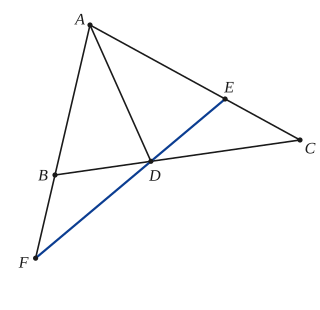
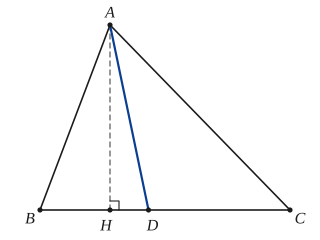

# Đề thi thử số 9

**Thời gian làm bài:** 120 phút. **Thang điểm:** mỗi câu 1 điểm, tổng 10 điểm.

## Đề bài

**Câu 1 (Tổng dãy).** Cho $A = \dfrac{1}{2} - \dfrac{1}{2^2} + \dfrac{1}{2^3} - \dots + \dfrac{1}{2^{99}} - \dfrac{1}{2^{100}}$. Chứng minh $A < \dfrac{1}{3}$.

**Câu 2 (Giá trị tuyệt đối).** Tìm $x, y$ biết $\lvert x + y - 3\rvert + (x - 2y)^2 = 0$.

**Câu 3 (Dãy tỉ số).** Tìm $x, y, z$ biết $\dfrac{x}{y + z + 1} = \dfrac{y}{x + z + 1} = \dfrac{z}{x + y - 2} = x + y + z$ (giả thiết các mẫu khác 0).

**Câu 4 (Vận tốc trung bình).** Một người đi từ A đến B, nửa quãng đường đầu với vận tốc 20 km/h, nửa quãng đường sau với vận tốc 30 km/h. Tính vận tốc trung bình trên cả quãng đường.

**Câu 5 (Đa thức).** Tìm đa thức bậc hai $P(x)$ biết $P(0) = 0$ và $P(x) - P(x - 1) = 2x$ với mọi $x$. Áp dụng tính $2 + 4 + 6 + \dots + 2n$.

**Câu 6 (Số nguyên tố).** Tìm số tự nhiên $n$ để $n^4 + 4$ là số nguyên tố.

**Câu 7 (Phương trình mũ).** Tìm các số tự nhiên $x, y$ thỏa mãn $2^x + 624 = 5^y$.

**Câu 8 (Tam giác bằng nhau).** Cho tam giác $ABC$ có $AB < AC$, tia phân giác $AD$ ($D \in BC$). Trên $AC$ lấy $E$ sao cho $AE = AB$. Đường thẳng $DE$ cắt tia đối của tia $BA$ tại $F$. Chứng minh $\triangle BDF = \triangle EDC$ và $AF = AC$.

**Câu 9 (Góc).** Cho tam giác $ABC$ có $\widehat{B} > \widehat{C}$, đường cao $AH$, tia phân giác $AD$. Chứng minh $\widehat{HAD} = \dfrac{\widehat{B} - \widehat{C}}{2}$.

**Câu 10 (Dirichlet).** Chứng minh rằng trong 7 số nguyên bất kỳ luôn có hai số mà tổng hoặc hiệu của chúng chia hết cho 10.

---

## Lời giải chi tiết

### Câu 1
$2A = 1 - \dfrac{1}{2} + \dfrac{1}{2^2} - \dots - \dfrac{1}{2^{99}}$. Cộng với $A$: $3A = 1 - \dfrac{1}{2^{100}} < 1$, nên $A < \dfrac{1}{3}$.

### Câu 2
Hai số hạng không âm có tổng 0 nên đều bằng 0: $x + y = 3$, $x = 2y$. Suy ra $y = 1$, $x = 2$.

### Câu 3
Nếu $x + y + z = 0$ thì $x = y = z = 0$ (kiểm tra thỏa mãn, các mẫu là $1, 1, -2$ khác 0). Nếu $x + y + z \ne 0$: theo dãy tỉ số, giá trị chung bằng $\dfrac{x + y + z}{2(x + y + z)} = \dfrac{1}{2}$, nên $x + y + z = \dfrac{1}{2}$.
Từ $x = \dfrac{1}{2}(y + z + 1) = \dfrac{1}{2}\left(\dfrac{1}{2} - x + 1\right)$: $x = \dfrac{1}{2}$. Tương tự $y = \dfrac{1}{2}$, $z = \dfrac{1}{2} - 1 = -\dfrac{1}{2}$.

**Đáp số:** $(0; 0; 0)$ hoặc $\left(\dfrac{1}{2}; \dfrac{1}{2}; -\dfrac{1}{2}\right)$.

### Câu 4
Đi 1 km nửa đầu hết $\dfrac{1}{20}$ giờ, nửa sau hết $\dfrac{1}{30}$ giờ. Đi 2 km (mỗi nửa 1 km) hết $\dfrac{1}{12}$ giờ. Vận tốc trung bình $2 : \dfrac{1}{12} = 24$ (km/h).

### Câu 5
$P(x) = ax^2 + bx$; $P(x) - P(x - 1) = 2ax - a + b = 2x$, nên $a = 1$, $b = 1$: $P(x) = x^2 + x$. Cộng các đẳng thức $P(k) - P(k - 1) = 2k$ với $k = 1, \dots, n$: $2 + 4 + \dots + 2n = P(n) = n(n + 1)$.

### Câu 6
$n^4 + 4 = (n^2 + 2)^2 - (2n)^2 = (n^2 - 2n + 2)(n^2 + 2n + 2)$. Muốn là số nguyên tố thì thừa số nhỏ $n^2 - 2n + 2 = (n - 1)^2 + 1 = 1$, tức $n = 1$; khi đó $n^4 + 4 = 5$.

**Đáp số:** $n = 1$.

### Câu 7
Nếu $x \ge 1$ thì vế trái chẵn, vế phải lẻ: vô lý. Vậy $x = 0$: $5^y = 625 = 5^4$, $y = 4$.

### Câu 8

*Hình: Tam giác ABC, phân giác AD, E trên AC với AE = AB, DE cắt tia AB tại F.*

$\triangle ABD = \triangle AED$ (c.g.c) nên $DB = DE$, $\widehat{ABD} = \widehat{AED}$, suy ra $\widehat{DBF} = \widehat{DEC}$ (kề bù với hai góc bằng nhau). $\triangle BDF = \triangle EDC$ (g.c.g: $\widehat{DBF} = \widehat{DEC}$, $DB = DE$, $\widehat{BDF} = \widehat{EDC}$ đối đỉnh). Suy ra $BF = EC$, nên $AF = AB + BF = AE + EC = AC$.

### Câu 9

*Hình: Tam giác ABC có đường cao AH và phân giác AD.*

$\widehat{BAH} = 90^\circ - \widehat{B}$, $\widehat{BAD} = \dfrac{\widehat{A}}{2} = \dfrac{180^\circ - \widehat{B} - \widehat{C}}{2}$. Vì $\widehat{B} > \widehat{C}$, tia $AH$ nằm giữa $AB$ và $AD$: $\widehat{HAD} = \widehat{BAD} - \widehat{BAH} = 90^\circ - \dfrac{\widehat{B} + \widehat{C}}{2} - 90^\circ + \widehat{B} = \dfrac{\widehat{B} - \widehat{C}}{2}$.

### Câu 10
Chia các số dư khi chia cho 10 thành 6 nhóm: $\{0\}$, $\{5\}$, $\{1; 9\}$, $\{2; 8\}$, $\{3; 7\}$, $\{4; 6\}$. 7 số nên có hai số có số dư cùng nhóm. Nếu cùng số dư thì hiệu chia hết cho 10; nếu hai số dư khác nhau trong cùng nhóm (tổng bằng 10) thì tổng chia hết cho 10.
