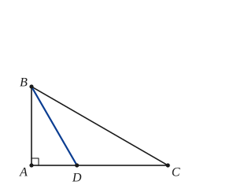
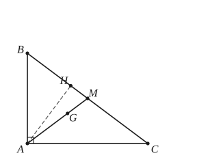

# Đề thi thử số 10

**Thời gian làm bài:** 120 phút. **Thang điểm:** mỗi câu 1 điểm, tổng 10 điểm.

## Đề bài

**Câu 1 (Tích phân số).** Tính $\left(1 + \dfrac{1}{2}\right)\left(1 + \dfrac{1}{3}\right)\cdots\left(1 + \dfrac{1}{2024}\right)$.

**Câu 2 (Giá trị tuyệt đối).** Tìm $x$ biết $\lvert x - 2025\rvert + \lvert x - 2026\rvert = 1$.

**Câu 3 (Dãy tỉ số).** Tìm $x, y, z$ biết $\dfrac{x - 1}{2} = \dfrac{y - 2}{3} = \dfrac{z - 3}{4}$ và $2x + 3y - z = 50$.

**Câu 4 (Kim đồng hồ).** Lúc 3 giờ, kim giờ và kim phút vuông góc với nhau. Hỏi sau ít nhất bao nhiêu phút nữa hai kim lại vuông góc với nhau?

**Câu 5 (Đa thức).** Cho đa thức $P(x)$ có các hệ số nguyên, biết $P(0)$ và $P(1)$ đều là số lẻ. Chứng minh $P(x)$ không có nghiệm nguyên.

**Câu 6 (Chia hết).** Chứng minh $7^6 + 7^5 - 7^4$ chia hết cho 11.

**Câu 7 (Nghiệm nguyên dương).** Tìm các cặp số nguyên dương $(x; y)$ thỏa mãn $5x + 7y = 112$.

**Câu 8 (Tam giác).** Cho tam giác $ABC$ vuông tại $A$ có $\widehat{B} = 60^\circ$. Tia phân giác của góc $B$ cắt $AC$ tại $D$. Chứng minh $DC = 2DA$.

**Câu 9 (Trọng tâm).** Tam giác $ABC$ vuông tại $A$, $AB = 6$ cm, $AC = 8$ cm, $G$ là trọng tâm. Tính $AM$ (trung tuyến) và khoảng cách từ $G$ đến $BC$.

**Câu 10 (Xác suất).** a) Ba bạn An, Bình, Chi xếp ngẫu nhiên thành một hàng. Tính xác suất An đứng đầu hàng. b) Tung ba đồng xu cân đối. Tính xác suất có ít nhất một đồng xu sấp.

---

## Lời giải chi tiết

### Câu 1
$\dfrac{3}{2} \cdot \dfrac{4}{3} \cdots \dfrac{2025}{2024} = \dfrac{2025}{2}$.

### Câu 2
$\lvert x - 2025\rvert + \lvert 2026 - x\rvert \ge 1$, dấu bằng khi $2025 \le x \le 2026$.

**Đáp số:** mọi $x$ với $2025 \le x \le 2026$.

### Câu 3
Đặt giá trị chung là $k$: $x = 2k + 1$, $y = 3k + 2$, $z = 4k + 3$. $2(2k + 1) + 3(3k + 2) - (4k + 3) = 9k + 5 = 50$, $k = 5$: $x = 11$, $y = 17$, $z = 23$.

### Câu 4
Mỗi phút kim phút quay $6^\circ$, kim giờ quay $0{,}5^\circ$, kim phút nhanh hơn $5{,}5^\circ$. Lúc 3 giờ kim giờ đi trước kim phút $90^\circ$. Hai kim vuông góc lần tiếp theo khi kim phút đi trước kim giờ $90^\circ$, tức kim phút phải đuổi thêm $180^\circ$: $180 : 5{,}5 = \dfrac{360}{11} = 32\dfrac{8}{11}$ (phút).

### Câu 5
Với số nguyên $n$: nếu $n$ chẵn thì $P(n) - P(0)$ chia hết cho $n - 0$, nên chia hết cho 2, do đó $P(n)$ cùng tính chẵn lẻ với $P(0)$, là số lẻ. Nếu $n$ lẻ thì $P(n) - P(1)$ chia hết cho $n - 1$ (số chẵn), nên $P(n)$ lẻ. Vậy $P(n) \ne 0$ với mọi số nguyên $n$.

*(Dùng tính chất: $a^k - b^k$ chia hết cho $a - b$, nên $P(a) - P(b)$ chia hết cho $a - b$.)*

### Câu 6
$7^4(49 + 7 - 1) = 7^4 \cdot 55 = 7^4 \cdot 5 \cdot 11$ chia hết cho 11.

### Câu 7
$5x = 112 - 7y$, cần $112 - 7y$ dương và chia hết cho 5: $7y$ chia 5 dư 2, tức $y$ chia 5 dư 1; $7y < 112$ nên $y < 16$: $y \in \{1; 6; 11\}$.

**Đáp số:** $(21; 1)$, $(14; 6)$, $(7; 11)$.

### Câu 8

*Hình: Tam giác ABC vuông tại A, góc B bằng 60 độ, BD là phân giác.*

$\widehat{C} = 30^\circ$, $\widehat{DBC} = 30^\circ = \widehat{C}$ nên tam giác $DBC$ cân: $DB = DC$. Tam giác $ABD$ vuông tại $A$ có $\widehat{ABD} = 30^\circ$ nên $DA = \dfrac{DB}{2}$. Vậy $DC = DB = 2DA$.

### Câu 9

*Hình: Tam giác ABC vuông tại A, AB = 6 cm, AC = 8 cm, trọng tâm G.*

$BC = 10$ cm, $AM = 5$ cm. Đường cao $AH = \dfrac{6 \cdot 8}{10} = 4{,}8$ cm. $GM = \dfrac{1}{3}AM$ nên khoảng cách từ $G$ đến $BC$ bằng $\dfrac{1}{3}AH = 1{,}6$ cm.

### Câu 10
a) Có 6 cách xếp, An đứng đầu có 2 cách: $P = \dfrac{1}{3}$. b) Biến cố đối “không có đồng sấp” có 1 kết quả trong 8: $P = 1 - \dfrac{1}{8} = \dfrac{7}{8}$.
